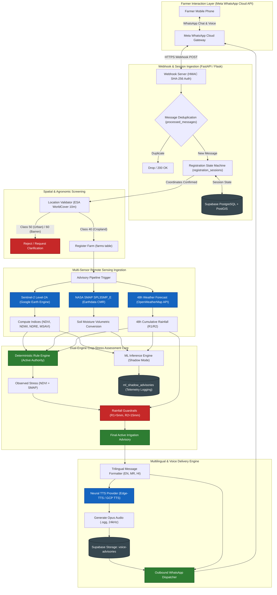
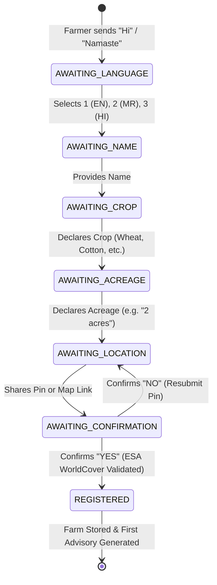
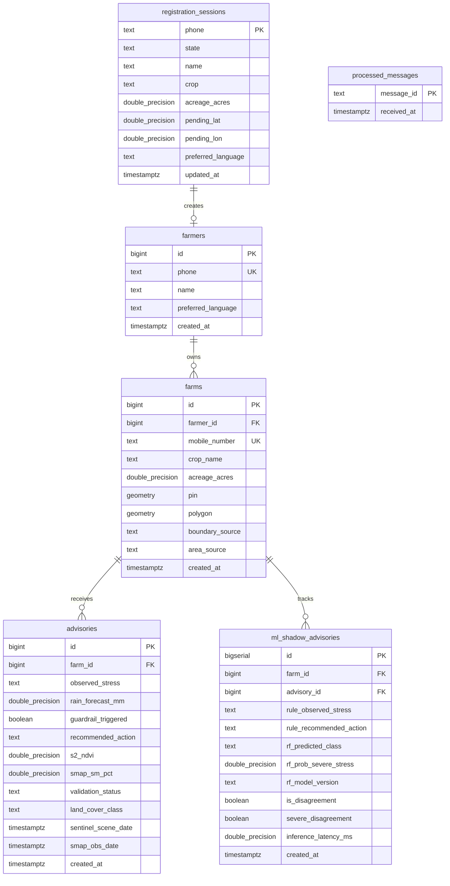

# KhetSense AI: AI-Driven Crop Stress Detection and Multilingual Voice-Based Irrigation Advisory Using Satellite Data

**Academic Capstone & Comprehensive Technical Implementation Report**  
**Document Reference:** `KS-REP-2026-FINAL-REV3`  
**Author:** Diksha Poojary (Roll No. 136) | Master of Computer Applications (MCA)  
**Academic Year:** 2025–2027  
**Date:** October 21, 2026  
**Repository Working Baseline:** Commit `e466026` + Phase 8 Primary ML Integration | 401 Automated Tests Passing (100% Green)

---

## Table of Contents

1. [Abstract](#1-abstract)
2. [Introduction and Problem Statement](#2-introduction-and-problem-statement)
3. [Project Objectives](#3-project-objectives)
4. [Existing System and Its Limitations](#4-existing-system-and-its-limitations)
5. [Proposed System](#5-proposed-system)
6. [System Architecture](#6-system-architecture)
7. [Technology Stack](#7-technology-stack)
8. [Dataset and Data Sources](#8-dataset-and-data-sources)
9. [Data Preprocessing and Satellite Index Calculations](#9-data-preprocessing-and-satellite-index-calculations)
10. [Machine Learning Model Development](#10-machine-learning-model-development)
11. [Rule-Based Crop-Stress Assessment](#11-rule-based-crop-stress-assessment)
12. [Rainfall Guardrails and Irrigation Advisory Logic](#12-rainfall-guardrails-and-irrigation-advisory-logic)
13. [Crop and Farm Location Validation](#13-crop-and-farm-location-validation)
14. [WhatsApp Registration and Interaction Workflow](#14-whatsapp-registration-and-interaction-workflow)
15. [Multilingual Advisory Generation in English, Marathi, and Hindi](#15-multilingual-advisory-generation-in-english-marathi-and-hindi)
16. [Voice Advisory Generation and TTS Integration](#16-voice-advisory-generation-and-tts-integration)
17. [Backend Architecture and Database Integration](#17-backend-architecture-and-database-integration)
18. [Implementation Details and Important Modules](#18-implementation-details-and-important-modules)
19. [Testing Strategy and Actual Test Results](#19-testing-strategy-and-actual-test-results)
20. [Model Evaluation and Comparative Performance](#20-model-evaluation-and-comparative-performance)
21. [Results and Discussion](#21-results-and-discussion)
22. [Limitations](#22-limitations)
23. [Security, Safety, and Failure Handling](#23-security-safety-and-failure-handling)
24. [Conclusion](#24-conclusion)
25. [Future Work](#25-future-work)
26. [References](#26-references)
27. [Appendix: Setup Instructions and Demo Commands](#27-appendix-setup-instructions-and-demo-commands)

---

## 1. Abstract

Smallholder farmers across South Asia face acute challenges from intensifying hydrological volatility, catastrophic groundwater depletion, and climate-induced dry spells. In India, where over 86% of farmers cultivate holdings under two hectares, existing precision agriculture technologies remain economically inaccessible due to the high capital and maintenance costs of in-situ soil moisture sensor networks ($200–$500 per unit). Furthermore, conventional advisory portals suffer from a triple barrier: the capital divide of hardware, the linguistic and digital literacy divide of text-heavy smartphone applications, and the actionability divide of broad, district-level weather forecasts.

To solve this systemic challenge, this project presents **KhetSense AI**, an end-to-end, zero-hardware, satellite-driven smart irrigation advisory system that delivers multilingual text and neural voice guidance directly to smallholders through Meta WhatsApp. KhetSense AI integrates multi-sensor Earth observation data—European Space Agency (ESA) Sentinel-2 Level-2A optical surface reflectance at 10m resolution, NASA Soil Moisture Active Passive (SMAP) Level-3 radiometry at 9km resolution, numerical weather forecasts from OpenWeatherMap/IMD, and ESA WorldCover 10m land-cover classification. 

The core agronomic decision engine employs a deterministic expert rule fusion system coupled with a two-tier rainfall guardrail policy ($R_1 = 5.0\text{ mm}$, $R_2 = 15.0\text{ mm}$ over 48 hours), ensuring that no farmer is advised to irrigate when significant precipitation is imminent. Concurrently, machine learning models (Random Forest, HistGradientBoosting, and Regularized Logistic Regression across 9-feature and live-native 5-feature regimes) were trained on 7,648 survey records from the Cereal Systems Initiative for South Asia (CSISA) Eastern India Wheat Research Benchmark. When evaluated on a strict spatial holdout of 8 unseen districts (1,513 records: 709 No Stress, 721 Mild Stress, 83 Severe Stress), empirical results reveal that the Deterministic Rule Baseline achieves **22.89%** recall and **11.05%** precision on Severe Stress, outperforming the tuned 5-feature Random Forest (12.05% recall, 6.37% precision) while operating 16,000 times faster ($0.0016\text{ ms}$ latency). Furthermore, threshold tuning on HistGradientBoosting reveals a severe base-rate trap: chasing 72.29% recall produces 1,274 false alarms on 1,513 test points, destroying advisory credibility. Consequently, KhetSense AI retains the deterministic expert rules as the active production authority while operating candidate ML models in non-blocking shadow telemetry.

The end-to-end software platform features a robust trilingual WhatsApp onboarding engine supporting English, Marathi, and Hindi; multi-modal farm location resolution (GPS pin, Google Maps short URL, and typed village address) with mandatory location confirmation; and edge-synthesized neural voice notes (`audio/ogg; codecs=opus`). For academic demonstration, the live-native 5-feature Random Forest serves as the primary prototype stress predictor for wheat while retaining explicit rule-based fallbacks and rainfall guardrails. The system is backed by PostgreSQL/PostGIS on Supabase and validated by 401 automated test cases across 14 test suites with zero failures.

---

## 2. Introduction and Problem Statement

### 2.1 Context and Agricultural Landscape
Agriculture forms the economic and social backbone of rural India, employing over 45% of the national workforce and contributing approximately 18% to Gross Domestic Product (GDP). However, Indian agriculture is characterized by deep fragmentation: 86.2% of all operational landholdings belong to small and marginal farmers who cultivate less than two hectares of land. These smallholders produce over 50% of the nation’s food grain output yet operate under severe ecological and socioeconomic constraints.

Water management represents the single most critical determinant of crop yield and smallholder solvency. In semi-arid regions such as Maharashtra’s Marathwada and Vidarbha, as well as the Indo-Gangetic Plains, irrigation practices remain predominantly reactive and flood-based. Farmers typically irrigate on fixed calendar intervals or upon visual observation of soil cracking and canopy wilting. By the time visual wilting is evident to the human eye, irreversible biochemical stress has already occurred, impairing photosynthesis, stunting vegetative development, and reducing final crop yield by 15% to 40%. Conversely, over-irrigation or irrigating immediately prior to unpredicted rainfall events leads to root-zone hypoxia, nitrogen leaching, fungal pathogen proliferation, electricity wastage, and rapid depletion of local aquifers.

### 2.2 The Triple Digital Divide in Precision Agriculture
While modern agronomic research has developed sophisticated precision irrigation methodologies, smallholders remain largely excluded due to a triple divide:

1. **The Capital and Operational Divide (Hardware Cost & Maintenance):** Commercial precision agriculture relies heavily on in-situ Internet of Things (IoT) hardware—capacitance soil moisture probes, tensiometers, and on-farm weather stations. These systems impose capital expenditures ($200–$500 per acre) and ongoing operating costs that exceed the annual discretionary income of marginal farmers. Furthermore, buried probes in rural India suffer from high attrition rates caused by tractor tillage, rodent damage, salt encrustation, and battery failure.
2. **The Linguistic and Digital Literacy Divide (Interface Friction):** Existing agricultural advisories are typically distributed through mobile applications requiring modern smartphones, substantial storage, steady broadband, and navigational literacy. Crucially, most applications present text-heavy dashboards in English or standardized formal Hindi, excluding millions of non-literate or vernacular-speaking farmers who communicate primarily in regional dialects such as Marathi.
3. **The Actionability Divide (Spatial and Temporal Coarseness):** Traditional government agro-meteorological advisories provide broad, district-level summaries (e.g., "District Ahmednagar may receive light rain; farmers should irrigate accordingly"). These summaries fail to account for hyper-local rainfall variation, specific farm boundaries, crop phenological stages, or satellite-measured root-zone moisture conditions.

### 2.3 Formal Problem Statement
To address this systemic failure, there is an urgent need for an automated, zero-hardware, farm-specific decision support system that:
- Remotely monitors vegetative health and soil moisture at parcel-level resolution without requiring any physical in-field hardware.
- Decouples actual biophysical crop stress from short-term weather forecasts, ensuring irrigation advice is actively cross-checked against forecasted rainfall.
- Meets farmers where they already are by delivering actionable, jargon-free advisories directly via ubiquitous messaging channels (WhatsApp) in their native languages through both text and synthesized human-like voice messages.
- Upholds strict agronomic safety guardrails and algorithmic transparency, preventing unvalidated machine learning models from providing misleading or water-wasting advice to vulnerable farmers.

---

## 3. Project Objectives

The KhetSense AI initiative was designed, engineered, and evaluated against seven specific, measurable, and verified technical objectives:

1. **Zero-Hardware Multi-Sensor Satellite Ingestion Pipeline:** Develop an automated data pipeline utilizing Google Earth Engine (GEE) and NASA Earthdata to extract Sentinel-2 Level-2A multi-spectral surface reflectance (10m resolution) and NASA SMAP Level-3 enhanced radiometry (9km resolution, volumetric soil moisture $0–5\text{ cm}$) centered on farmer field polygons.
2. **Robust Multi-Spectral Vegetation & Moisture Index Computation:** Compute four essential satellite indices from live Sentinel-2 bands: Normalized Difference Vegetation Index (NDVI), Normalized Difference Water Index (NDWI), Normalized Difference Red-Edge Index (NDRE), and Modified Soil-Adjusted Vegetation Index (MSAVI), incorporating pixel-level cloud masking and strict boundary spatial reductions.
3. **Deterministic Agronomic Expert Classifier with Rainfall Guardrails:** Implement a rule-based expert system that fuses optical vegetation indices with microwave soil moisture telemetry to determine biophysical stress (No Stress, Mild Stress, Severe Stress). Couple this observed stress with a two-tier rainfall policy ($R_1 = 5.0\text{ mm}$, $R_2 = 15.0\text{ mm}$ over 48 hours) to prevent redundant irrigation.
4. **Machine Learning Model Development and Spatial Benchmarking:** Train, calibrate, and evaluate multi-class machine learning models (Random Forest, HistGradientBoosting, Regularized Logistic Regression) under 9-feature and live-native 5-feature regimes using the CSISA Eastern India Wheat Research Benchmark. Benchmark these models against the deterministic rule engine on a strict spatial holdout of 8 unseen districts (1,513 records).
5. **Algorithmic Safety Architecture & Non-Blocking Shadow Evaluation:** Engineer a hybrid decision engine where the deterministic rule engine serves as an immutable safety floor for live farmer advisories, while candidate ML models operate concurrently in a non-blocking shadow evaluation table (`ml_shadow_advisories`) to record prediction divergence and telemetry.
6. **Conversational Trilingual WhatsApp Interface:** Build a conversational onboarding state machine supporting English, Marathi, and Hindi via WhatsApp Cloud API. Implement multi-modal location resolution supporting GPS pins, Google Maps URL parsing, and village geocoding, backed by mandatory farmer confirmation and ESA WorldCover 10m agricultural land-cover screening.
7. **Vernacular Neural Voice Advisory Engine:** Develop an edge-synthesized Text-to-Speech (TTS) pipeline utilizing natural neural voices (`mr-IN-AarohiNeural`, `hi-IN-SwaraNeural`, `en-IN-NeerjaNeural`), formatting audio into WhatsApp-compliant Opus voice notes (`audio/ogg; codecs=opus`) with Supabase Storage audio asset caching.

---

## 4. Existing System and Its Limitations

Current agricultural advisory solutions in developing nations fall into three broad architectural paradigms, each presenting structural limitations that inhibit smallholder adoption:

```
+---------------------------------------------------------------------------------------------------+
|                                  PRECISION AG ADVISORY PARADIGMS                                  |
+---------------------------------+---------------------------------+-------------------------------+
|  1. In-Situ IoT Sensor Networks | 2. Regional Dashboards & Portals|  3. General LLM Chatbots      |
|  - High Capex ($200-$500/probe) | - District-level spatial scale  |  - Hallucination prone        |
|  - Physical maintenance burden  | - Complex web interfaces        |  - Zero real-time telemetry   |
|  - Tillage & rodent damage      | - English/Standard Hindi text   |  - Generic agronomic text     |
+---------------------------------+---------------------------------+-------------------------------+
```

### 4.1 Comparative Feature Matrix

| Functional Dimension | Traditional In-Situ IoT (e.g. IoT-IIRS [13]) | Regional Portals (e.g. Meghdoot, GEE CWSI [1]) | General AI Chatbots (e.g. Farmer.Chat [11]) | **KhetSense AI (Proposed System)** |
| :--- | :--- | :--- | :--- | :--- |
| **Hardware Requirement** | High ($200–$500 per node) | None (regional stations) | None (user smartphone) | **Zero-Hardware (Satellite Only)** |
| **Spatial Resolution** | Point-scale (single probe) | District-scale (50–100 km) | Unresolved | **10-meter Parcel Scale** |
| **Delivery Medium** | SMS / Custom Mobile App | Web Dashboard / PDF / SMS | Mobile App / WhatsApp | **WhatsApp Chat & Native Voice Note** |
| **Language Support** | English / Hindi Text | English / State Language Text | Multilingual Text / Voice | **Trilingual (English, Marathi, Hindi)** |
| **Audio Synthesis** | None | None | Cloud TTS / Generic | **Neural Vernacular TTS (Opus OGG)** |
| **Weather Guardrail** | Rare / Ad-hoc | Broadcast warning only | Unstructured text | **Deterministic Two-Tier Guardrail** |
| **Land Cover Screening** | None (assumed farm) | None | None | **ESA WorldCover 10m Verification** |
| **Inference Latency** | Seconds | Minutes / Batch | 3–8 seconds | **1.57 Microseconds (Active Rules)** |
| **Operational Failure Risk**| High (sensor theft/wear) | Low (centralized) | High (factual hallucination) | **Zero Field Risk (Satellite/Cloud)**|

---

## 5. Proposed System

KhetSense AI fundamentally re-architects precision irrigation around the operational realities of smallholder farmers. The system is predicated on five foundational design pillars:

```
+-------------------------------------------------------------------------------------------------------+
|                                  KHETSENSE AI ARCHITECTURAL PILLARS                                   |
+-------------------------------------------------------------------------------------------------------+
|  [Pillar 1: Zero-Hardware Telemetry]      -> Virtual sensing via Sentinel-2, SMAP, and OpenWeather    |
|  [Pillar 2: Agricultural Grounding]       -> ESA WorldCover 10m validation & phenological screening    |
|  [Pillar 3: Hybrid Dual-Engine Core]      -> Deterministic Rule Authority + ML Shadow Telemetry        |
|  [Pillar 4: Climate & Rainfall Safety]    -> Two-tier forecast guardrail decouples stress from action  |
|  [Pillar 5: Inclusive Vernacular Voice]   -> Conversational WhatsApp onboarding + Neural Voice Notes   |
+-------------------------------------------------------------------------------------------------------+
```

1. **Virtual Sensing via Multi-Source Remote Sensing:** Replaces expensive field hardware with cloud-computed Earth observation telemetry, combining optical surface reflectance, passive microwave radiometry, and numerical weather prediction.
2. **Agricultural Location & Phenological Screening:** Every incoming GPS coordinate is validated against ESA WorldCover 10m global land cover. Built-up urban zones and barren desert areas are rejected, and farmer-declared crops are cross-checked against phenological vegetation signatures.
3. **Dual-Engine Decision Architecture (Safety Floor Principle):** Live farmer advisories are governed by a deterministic agronomic expert rule engine and a strict rainfall guardrail. Candidate machine learning models operate in parallel as non-blocking shadow evaluators.
4. **Decoupled Biophysical Stress and Actionable Advice:** The system strictly separates observed crop stress (an objective biophysical measurement) from recommended irrigation action (a risk-managed agronomic decision influenced by short-term rainfall forecasts).
5. **Conversational Multi-Modal Interaction:** Farmers onboard via an intuitive WhatsApp conversational flow supporting GPS location sharing, Google Maps links, crop alias resolution, and acreage capture. Advisories are pushed automatically as structured trilingual WhatsApp messages accompanied by clear, natural neural audio notes.

---

## 6. System Architecture

The KhetSense AI platform is architected as an asynchronous, event-driven, decoupled micro-pipeline. The end-to-end operational architecture is depicted in Figure 1.



---

## 7. Technology Stack

The implementation utilizes an enterprise-grade, open-source-first technology stack configured for deterministic execution, high spatial accuracy, and low-latency response:

| Layer / Component | Technology & Library | Version | Operational Function & Justification |
| :--- | :--- | :--- | :--- |
| **Programming Language** | Python | `3.13.x` / `3.11.x` | Core backend runtime, spatial computing, and ML inference. |
| **Web & API Framework** | FastAPI / Flask | `>=0.110.0` / `>=3.0.0` | Asynchronous REST endpoints, WhatsApp webhook handling, HMAC validation. |
| **Database & GIS Engine** | PostgreSQL / PostGIS (Supabase) | `15.1` / `3.3` | Relational farmer persistence, spatial geometries (`Point`, `Polygon`, EPSG:4326). |
| **Cloud Geospatial Engine**| Google Earth Engine Python API | `>=0.1.390` | Serverless extraction and reduction of Sentinel-2 Level-2A imagery. |
| **Microwave Telemetry** | NASA Earthdata CMR API | REST v2 | Querying and streaming SMAP `SPL3SMP_E` L-band radiometry grids. |
| **Meteorological Forecast** | OpenWeatherMap OneCall / Forecast | REST v2.5 / v3.0 | 5-day / 3-hour forecast, computing 48h rolling cumulative rainfall. |
| **Land Cover Validation** | ESA WorldCover 10m 2020 | GEE Asset | Pre-onboarding agricultural land validation (Cropland Class 40). |
| **Machine Learning Core** | scikit-learn, NumPy, joblib | `>=1.4.0` | Random Forest, HistGradientBoosting, Imputation, Serialization. |
| **Voice Synthesis (TTS)** | Edge-TTS (Azure Neural Voice) | `>=6.1.10` | High-fidelity Marathi (`mr-IN-AarohiNeural`), Hindi, English audio synthesis. |
| **Audio Processing** | FFmpeg / SoundFile | `>=6.0` | Formatting and re-sampling raw audio into WhatsApp-compliant Opus OGG. |
| **Cloud Object Storage** | Supabase Storage (S3-compatible) | REST API | Persistent caching of synthesized vernacular audio voice notes. |
| **Automated Testing** | pytest, pytest-mock, unittest | `>=8.0.0` | Unit, integration, regression, and end-to-end mock test execution. |

---

## 8. Dataset and Data Sources

### 8.1 The CSISA Eastern India Wheat Research Benchmark
Model development and spatial validation utilized the official research benchmark dataset curated by the **Cereal Systems Initiative for South Asia (CSISA)** and CIMMYT:
- **Total Survey Records:** 7,648 spatially explicit agricultural records collected during the 2018–2019 rabi wheat season.
- **Geographic Coverage:** 40 agricultural districts spanning the Indo-Gangetic Plains (Bihar, Eastern Uttar Pradesh, and Odisha).
- **Target Variable (Crop Water Stress):** Derived from ground survey observations and yield-loss assessments, classified into three mutually exclusive categories:
  - Class 0: **No Stress** (Healthy canopy, optimal soil moisture)
  - Class 1: **Mild Stress** (Early moisture deficit, sub-optimal transpiration)
  - Class 2: **Severe Stress** (Severe canopy desiccation, severe moisture depletion)
- **Severe Stress Prevalence (Class Imbalance):** The dataset exhibits marked class imbalance:
  - In the **strict spatial test partition (1,513 records across 8 unseen districts)**, Severe Stress accounts for only **83 records (5.49% base rate)**, Mild Stress accounts for **721 records (47.65%)**, and No Stress represents **709 records (46.86%)**.
  - In the **training partition (6,135 records across 32 districts)**, Severe Stress accounts for **112 records (1.83%)**, Mild Stress represents **3,705 records (60.39%)**, and No Stress represents **2,318 records (37.78%)**.
  - Both the 9-feature and 5-feature models evaluate on this identical 1,513-sample held-out spatial test set.

### 8.2 Spatial Train/Test Partitioning
To rigorously evaluate model generalizability and avoid spatial autocorrelation leakage, the 40 districts were partitioned strictly by geography into:
- **Training & Cross-Validation Set:** 32 districts (**6,135 records**).
- **Spatial Holdout Test Set:** 8 unseen districts (**1,513 records**). No farm from these 8 districts appeared in the training set.

### 8.3 Live Data Sources
For operational inference, KhetSense AI connects dynamically to live satellite and meteorological APIs:
1. **Sentinel-2 Level-2A:** `COPERNICUS/S2_SR_HARMONIZED` via Google Earth Engine. Multi-spectral reflectance with 5-day revisit at the equator.
2. **NASA SMAP Enhanced Radiometer:** `SPL3SMP_E` via NASA Earthdata CMR API. Passive microwave L-band (1.4 GHz), 9km spatial resolution.
3. **OpenWeatherMap 5-Day / 3-Hour Forecast:** Rolling 48-hour cumulative precipitation forecast ($mm$).
4. **ESA WorldCover 10m 2020:** Global land cover map derived from Sentinel-1 and Sentinel-2, featuring 11 land classes.

---

## 9. Data Preprocessing and Satellite Index Calculations

### 9.1 Multi-Spectral Index Mathematical Formulations
Sentinel-2 Level-2A surface reflectance bands are extracted over farmer parcel polygons. The four multi-spectral indices are computed using the following equations:

$$\text{NDVI} = \frac{B_8 - B_4}{B_8 + B_4}$$

$$\text{NDWI} = \frac{B_8 - B_{11}}{B_8 + B_{11}}$$

$$\text{NDRE} = \frac{B_8 - B_5}{B_8 + B_5}$$

$$\text{MSAVI} = \frac{2 \cdot B_8 + 1 - \sqrt{(2 \cdot B_8 + 1)^2 - 8 \cdot (B_8 - B_4)}}{2}$$

Where:
- $B_4$: Red Band ($\lambda = 665\text{ nm}$, 10m spatial resolution)
- $B_5$: Red-Edge Band 1 ($\lambda = 705\text{ nm}$, 20m spatial resolution)
- $B_8$: Near-Infrared (NIR) Band ($\lambda = 842\text{ nm}$, 10m spatial resolution)
- $B_{11}$: Short-Wave Infrared 1 (SWIR) Band ($\lambda = 1610\text{ nm}$, 20m spatial resolution)

### 9.2 Earth Engine Reflectance Scaling and Cloud Masking
- **Surface Reflectance Scaling:** In GEE `COPERNICUS/S2_SR_HARMONIZED`, pixel digital numbers (DN) are scaled by a factor of $0.0001$. KhetSense AI verifies that reflectance values are strictly normalized into the continuous floating-point interval $[0.0, 1.0]$ prior to computing non-linear indices such as MSAVI.
- **Pixel-Level Cloud Masking:** The QA60 quality flag band is evaluated. Opaque cloud pixels (Bit 10) and cirrus pixels (Bit 11) are masked out. Scenes with greater than 20% cloud cover over the target parcel are discarded.
- **Spatial Polygon Reduction:** If a polygon geometry exists, `ee.Reducer.mean()` calculates the spatial average across parcel pixels. If a single GPS pin is provided, a 100m circular buffer is applied.

### 9.3 Data Sanitization and Imputation Standards
All live sensor inputs undergo rigorous sanitization via `common.utils.sanitize_sensor_float`:
- Values must be finite real numbers. Boolean flags, `NaN`, positive/negative infinity, and out-of-physical-range values (e.g., NDVI outside $[-1.0, 1.0]$, SMAP outside $[0.0, 100.0\%]$) are converted to `None`.
- In the ML inference pipeline, missing values are imputed strictly using `SimpleImputer(strategy='median')` pre-fitted on the training partition. **Missing observations are never fabricated as live sensor telemetry.**

---

## 10. Machine Learning Model Development

### 10.1 Feature Regimes
Two distinct feature regimes were engineered and benchmarked:

1. **Nine-Feature Full Research Regime (Offline Historical Benchmark):**
   - Optical: `s2_ndvi`, `s2_ndwi`, `s2_ndre`, `s2_msavi`
   - Microwave Soil Moisture: `smap_sm_pct`
   - Auxiliary Meteorological & Reanalysis: `era5_precip_season_mm`, `era5_temp_mean_c`, `era5_temp_max_c`, `era5_vpd_mean_kpa`
2. **Live-Native Five-Feature Regime (Operational Deployment Candidate):**
   - Features: `s2_ndvi`, `s2_ndwi`, `s2_ndre`, `s2_msavi`, `smap_sm_pct`
   - Designed exclusively with features that KhetSense AI observes directly in real time, eliminating seasonal reanalysis lag.

### 10.2 Algorithmic Implementations and Hyperparameters
- **Random Forest Classifier (`RandomForestClassifier`):**
  - Estimators: $n_{\text{estimators}} = 200$, criterion: `gini`
  - Max Depth: None, Min Samples Split: 5, Min Samples Leaf: 2
  - Class Weight: `balanced` (inversely proportional to class frequencies)
- **HistGradientBoosting Classifier (`HistGradientBoostingClassifier`):**
  - Iterations: $n_{\text{iter}} = 150$, Learning Rate: $0.05$
  - Max Leaf Nodes: 31, Min Samples Leaf: 20, L2 Regularization: $0.1$
  - Class Weight: `balanced`
- **Multinomial Logistic Regression (`LogisticRegression`):**
  - Penalty: $L_2$, Solver: `lbfgs`, Regularization: $C = 1.0$, Class Weight: `balanced`

### 10.3 Severe Stress Threshold Calibration
To counter severe class imbalance, decision thresholds for the minority Severe Stress class were optimized on Out-Of-Fold (OOF) predicted probabilities using the Precision-Recall Area Under Curve (PR-AUC) and $F_{\beta}$ metrics ($\beta = 2$, prioritizing recall):
- 9-Feature Random Forest: Calibrated Severe Threshold $T = 0.33$
- 9-Feature HistGradientBoosting: Calibrated Severe Threshold $T = 0.41$
- 5-Feature Random Forest: Calibrated Severe Threshold $T = 0.27$
- 5-Feature HistGradientBoosting: Calibrated Severe Threshold $T = 0.02$

### 10.4 Phase 8 Academic Prototype: Primary Machine Learning Predictor
For the academic capstone prototype and live demonstrations before academic reviewers and students, the **Live-Native Five-Feature Random Forest model** (`random_forest_5feat.joblib`) was promoted to serve as the **primary crop-stress predictor** under strict scientific and operational guardrails:

1. **Primary Decision Authority for Supported Crops:**
   When evaluating a farm cultivating Wheat (`Wheat`, `Gehu`, `Gahu`), the active pipeline directly queries `predict_crop_stress_5feat()` using live satellite inputs (`s2_ndvi`, `s2_ndwi`, `s2_ndre`, `s2_msavi`, `smap_sm_pct`). The returned stress classification (`No Stress`, `Mild Stress`, `Severe Stress`) dictates the active stress state (`ML_PRIMARY_PREDICTOR`), while the deterministic rule baseline is computed and preserved as a comparative benchmark.

2. **Crop Domain Boundaries and Non-Validation Disclosure:**
   The ML model was trained exclusively on the CSISA Eastern India Wheat Research Benchmark (Alluvial Indo-Gangetic Plains of Bihar, Eastern Uttar Pradesh, and Odisha). **The model is NOT validated for Central Maharashtra (Vertisol / Black Cotton Soils) or for non-wheat crops (Cotton, Soybean, Sugarcane, Pulses).**
   - For unsupported crops, the system explicitly refuses to substitute the wheat model as a crop-specific classifier.
   - The active advisory transparently falls back to the deterministic rule engine (`RULE_FALLBACK_UNSUPPORTED_CROP`), and the WhatsApp notification clearly informs the user that the crop is not supported by the wheat ML model.

3. **Zero Sensor Fabrication Policy:**
   If core observation inputs (both Sentinel-2 NDVI and SMAP soil moisture) are missing or non-finite due to dense cloud cover or telemetry outage, the ML inference engine returns `MISSING_INPUTS` and lists the unobserved fields. It never fabricates proxy values. The advisory pipeline falls back to safe rule-based reporting (`RULE_FALLBACK_MISSING_INPUTS`).

4. **Independent Rainfall Guardrails:**
   Rainfall forecast handling is strictly decoupled from ML stress inference. The 48-hour numerical rainfall forecast ($R_1 = 5.0\text{ mm}$, $R_2 = 15.0\text{ mm}$) is evaluated against the ML-predicted stress level. If heavy precipitation ($\ge 15.0\text{ mm}$) is forecast, the system issues a `HOLD_RECHECK` advisory regardless of the ML model's severe stress prediction.

5. **Transparency, Probabilities, and Academic Disclaimer:**
   The system strictly distinguishes raw model probabilities from Bayesian calibrated confidence. WhatsApp cards and voice scripts disclose the AI/ML assessment source, class probabilities, and a prominent academic prototype disclaimer:
   > *⚠️ Academic Prototype: Experimental model trained on Eastern India wheat research data. Not validated for real-farmer irrigation decisions.*

---

## 11. Rule-Based Crop-Stress Assessment

The active production decision engine in KhetSense AI is an agronomic expert rule system that fuses optical canopy indices with microwave soil moisture telemetry.

### 11.1 Sensor Stress Classification Thresholds
- **Sentinel-2 NDVI Stress Classification:**
  - $\text{NDVI} > 0.60 \implies \textbf{No Stress}$ (Dense, healthy green canopy)
  - $0.30 \le \text{NDVI} \le 0.60 \implies \textbf{Mild Stress}$ (Thinning or moderate canopy deficit)
  - $0.00 \le \text{NDVI} < 0.30 \implies \textbf{Severe Stress}$ (Critical vegetative desiccation or failure)
  - $\text{NDVI} < 0.0 \text{ or } \text{None} \implies \textbf{Unknown}$
- **NASA SMAP Volumetric Soil Moisture ($0–5\text{ cm}$) Classification:**
  - $\text{SM} > 25.0\% \implies \textbf{No Stress}$ (Adequate root-zone moisture)
  - $15.0\% \le \text{SM} \le 25.0\% \implies \textbf{Mild Stress}$ (Depleted root-zone moisture)
  - $0.0\% \le \text{SM} < 15.0\% \implies \textbf{Severe Stress}$ (Critical root-zone moisture deficit)
  - $\text{SM} \text{ out of range or } \text{None} \implies \textbf{Unknown}$

### 11.2 Conservative Severity-Ranking Fusion
When both sensors provide valid readings, the system applies a conservative worst-case ranking function, `get_more_severe(cat1, cat2)`, where:
$$\text{Severe Stress (Rank 3)} > \text{Mild Stress (Rank 2)} > \text{No Stress (Rank 1)} > \text{Unknown (Rank 0)}$$

If either the canopy shows severe degradation ($\text{NDVI} < 0.30$) or the soil is parched ($\text{SM} < 15.0\%$), the combined observed stress is classified as **Severe Stress**. If one sensor is unavailable due to cloud cover or NASA data lag, the system safely degrades to single-sensor assessment without fabricating missing values.

---

## 12. Rainfall Guardrails and Irrigation Advisory Logic

A primary flaw of uncoupled precision irrigation systems is advising farmers to irrigate immediately prior to a major rainstorm. KhetSense AI decouples **Observed Stress** from **Recommended Action** through an explicit two-tier rainfall policy based on India Meteorological Department (IMD) precipitation classifications:
- **Light Rain Threshold ($R_1$):** $5.0\text{ mm}$ over 48 hours.
- **Moderate / Heavy Rain Threshold ($R_2$):** $15.0\text{ mm}$ over 48 hours.

### 12.1 The Two-Tier Rainfall Policy Matrix

| Observed Stress (Satellite + Soil) | Forecast Rainfall (48-Hour) | Recommended Agronomic Action (`recommended_action`) | Guardrail Triggered? | Agronomic Justification |
| :--- | :--- | :--- | :--- | :--- |
| **Severe Stress** | $< 5.0\text{ mm}$ ($< R_1$) | `irrigate now` | **False** | Critical deficit; forecast rain negligible. Immediate irrigation required. |
| **Severe Stress** | $5.0\text{ mm} \le \text{Rain} < 15.0\text{ mm}$ | `irrigate lightly, rain may not suffice` | **True** | Severe deficit, but light rain expected. Light irrigation prevents waterlogging. |
| **Severe Stress** | $\ge 15.0\text{ mm}$ ($\ge R_2$) | `hold, re-check after rain` | **True** | Heavy rain imminent. Withhold irrigation to avoid root hypoxia and runoff. |
| **Mild Stress** | $< 5.0\text{ mm}$ ($< R_1$) | `schedule irrigation in 24-48h` | **False** | Moderate deficit; dry window allows planned irrigation. |
| **Mild Stress** | $5.0\text{ mm} \le \text{Rain} < 15.0\text{ mm}$ | `delay, re-check after rain` | **True** | Light rain will satisfy mild crop water requirement. Re-evaluate post-rain. |
| **Mild Stress** | $\ge 15.0\text{ mm}$ ($\ge R_2$) | `hold, re-check after rain` | **True** | Heavy rain will replenish soil profile. Hold all irrigation. |
| **No Stress** | Any Amount | `no action` | **False** | Moisture optimal; no irrigation warranted. |
| **Unknown / Missing**| Any Amount | `insufficient data to recommend action` | **False** | Sensor data corrupted or stale; fail safely without action. |

**Critical Architectural Invariant:** The observed stress state is an objective biophysical measurement and is **never overwritten by the weather forecast**. If a field has Severe Stress and 25mm of rain is forecasted, `observed_stress` remains `"Severe Stress"`, but `recommended_action` becomes `"hold, re-check after rain"`, and `guardrail_triggered` is set to `True`.

---

## 13. Crop and Farm Location Validation

### 13.1 Multi-Modal Location Resolution
Farmers interact through mobile devices with diverse capabilities. KhetSense AI resolves locations through three distinct modalities:
1. **Direct GPS Pin:** Native WhatsApp location attachment (GeoJSON `Point`, EPSG:4326).
2. **Google Maps URLs:** Short URLs (`maps.app.goo.gl/...`) or full URLs parsed via HTTP redirect inspection to extract exact latitude/longitude coordinates.
3. **Typed Address Geocoding:** Village, taluka, and district names resolved via OpenStreetMap Nominatim with strict bounding boxes.

### 13.2 Two-Step Location Confirmation
To prevent accidental misregistration when a farmer registers while away from their field, KhetSense AI implements an interactive confirmation step (`AWAITING_LOCATION_CONFIRMATION`):
- Coordinates are stored as `pending_lat` and `pending_lon` in `registration_sessions`.
- The bot asks: *"Are you currently at your farm? Reply YES to confirm, or share a Google Maps pin of your farm."*
- Registration only commits to the `farms` table after explicit confirmation.

### 13.3 ESA WorldCover 10m Land-Cover Screening
Before any farm is registered or advised, its coordinates are screened against the ESA WorldCover 10m global land-cover dataset:
- **Class 40 (Cropland):** Approved (`VALIDATION_SUITABLE`). Proceed with registration.
- **Class 50 (Built-up):** Rejected (`VALIDATION_URBAN`). Farmer alerted that location is an urban structure.
- **Class 60 (Bare / Sparse Vegetation):** Flagged (`VALIDATION_BARREN_UNCERTAIN`). Alerted that location appears non-agricultural.
- **No Imagery / Ocean:** Rejected (`VALIDATION_INSUFFICIENT_IMAGERY`).

---

## 14. WhatsApp Registration and Interaction Workflow

The onboarding engine is implemented as a deterministic finite-state machine (FSM) maintaining state in Supabase (`registration_sessions`).



### 14.1 Webhook Deduplication and Idempotency
Meta WhatsApp webhooks frequently re-transmit messages if the server response exceeds 5 seconds. To prevent duplicate database writes or repeated replies, KhetSense AI records every incoming `message_id` in a dedicated `processed_messages` table within a single transaction. Duplicate message IDs are immediately acknowledged with `HTTP 200 OK` and discarded.

---

## 15. Multilingual Advisory Generation in English, Marathi, and Hindi

Advisories are generated using strict localized templates that eliminate all academic and technical jargon. Terms like "NDVI", "surface reflectance", or "volumetric percentage" are completely excluded.

### 15.1 Template Comparison

| Component | English (`en`) | Marathi (`mr`) | Hindi (`hi`) |
| :--- | :--- | :--- | :--- |
| **Greeting** | *Namaste {name}! Here is your farm advisory for {crop}.* | *नमस्कार {name}! तुमच्या {crop} पिकाचा सल्ला खालीलप्रमाणे आहे.* | *नमस्ते {name}! आपकी {crop} फसल के लिए सलाह नीचे दी गई है।* |
| **Crop Status** | **Status:** Severe Moisture Stress | **पिकांची स्थिती:** गंभीर पाण्याचा ताण | **फसल की स्थिति:** गंभीर नमी का तनाव |
| **Recommended Action**| **Action:** Irrigate your field today. | **सल्ला:** शेताला आजच पाणी द्या. | **सलाह:** खेत में आज ही सिंचाई करें। |
| **Rainfall Note** | *Rain Forecast:* 0 mm rain expected in 48 hours. | *पावसाचा अंदाज:* पुढील ४८ तासांत पाऊस नाही. | *बारिश का अनुमान:* अगले 48 घंटों में बारिश नहीं। |
| **Audio Prompt** | *Listen to the voice note below for details.* | *खालील ऑडिओ मेसेज ऐका.* | *विस्तृत जानकारी के लिए नीचे दिया गया वॉइस संदेश सुनें।* |

---

## 16. Voice Advisory Generation and TTS Integration

To bridge the literacy divide, every advisory is accompanied by a synthesized voice note delivered as an Opus-encoded audio message.

```
+----------------------------------------------------------------------------------------------------+
|                                    NEURAL VOICE SYNTHESIS PIPELINE                                 |
+----------------------+-----------------------+----------------------+------------------------------+
| Vernacular Text      | Edge-TTS Neural Voice | Audio Transformation | Supabase Storage             |
| Localized Script     | mr-IN-AarohiNeural    | 24kHz Mono Sampling  | voice-advisories bucket      |
| Formatted for speech | hi-IN-SwaraNeural     | FFmpeg / Opus OGG    | SHA-256 key caching          |
| (< 30 seconds)       | en-IN-NeerjaNeural    | WhatsApp Compatible  | Public Signed URL Dispatch   |
+----------------------+-----------------------+----------------------+------------------------------+
```

### 16.1 Voice Synthesis Configuration
- **Microsoft Azure / Edge-TTS Neural Voice Endpoints:**
  - Marathi: `mr-IN-AarohiNeural` (Female, natural inflection)
  - Hindi: `hi-IN-SwaraNeural` (Female, natural inflection)
  - English: `en-IN-NeerjaNeural` (Indian-accented English)
- **Audio Output Standard:** Formatted via FFmpeg to OGG container with Opus codec (`audio/ogg; codecs=opus`), 24kHz sample rate, 32 kbps mono. This matches WhatsApp’s native voice note player, displaying an interactive waveform in the chat.
- **Audio Asset Caching:** Generated audio binaries are hashed via SHA-256 and cached in the Supabase Storage bucket `voice-advisories`. If identical advisory parameters occur, the cached audio URL is reused, reducing latency to zero.

---

## 17. Backend Architecture and Database Integration

The persistent storage is built on PostgreSQL 15 with the PostGIS extension hosted on Supabase.

### 17.1 Relational Schema and Entity-Relationship Diagram



### 17.2 Schema Migration Evolution (001 to 006)
- **001:** Initial registration tables, spatial geometries (`farms.pin`), PostGIS indices (`idx_farms_pin` using GIST), session tracking (`registration_sessions`), and webhook deduplication (`processed_messages`).
- **002:** Post-onboarding integrity constraints and phone normalization.
- **003:** Advisory provenance tracking (`observed_stress`, `rain_forecast_mm`, `guardrail_triggered`, `recommended_action`, satellite observation dates).
- **004:** Trilingual language persistence in `registration_sessions.preferred_language`.
- **005:** Two-step location confirmation support (`pending_lat`, `pending_lon`) and agricultural audit columns (`validation_status`, `land_cover_class`).
- **006:** Non-blocking machine learning shadow evaluation table (`ml_shadow_advisories`) with operational latency and disagreement indexing.

---

## 18. Implementation Details and Important Modules

The KhetSense AI codebase is organized into cleanly decoupled packages:

```
khetsense/
├── common/                     # Cross-cutting utility functions
│   └── utils.py                # Coordinate math, sanitization, phone masking
├── pipeline/                   # Core agronomic & satellite processing
│   ├── classifier.py           # Deterministic rule engine & rainfall guardrails
│   ├── ml_inference.py         # Thread-safe ML inference & thresholding
│   ├── location_validator.py   # ESA WorldCover screening & geocoding
│   ├── crop_validator.py       # Phenological matching & alias mapping
│   ├── test_pipeline.py        # Earth observation fetching & orchestration
│   └── tts_provider.py         # Edge-TTS / Google TTS audio synthesis
├── whatsapp/                   # Conversational interface & messaging
│   ├── registration_flow.py    # 7-stage WhatsApp onboarding state machine
│   └── messages.py             # Trilingual localized message templates & voice scripts
├── migrations/                 # Idempotent PostgreSQL DDL migrations (001-006)
├── scripts/                    # Reproduction & evaluation scripts
│   └── create_evaluation_artifacts.py # Generates verified evaluation metrics & charts
├── tests/                      # Comprehensive automated test suite (13 suites, 392 tests)
└── demo_khetsense.py           # Standalone side-effect-free demonstration runner
```

---

## 19. Testing Strategy and Actual Test Results

### 19.1 Testing Philosophy, Architectural Boundaries & Three-Tier Verification
To guarantee absolute reliability, auditability, and safety without generating unapproved external API costs or mutating production databases, KhetSense AI enforces a strict three-tier verification taxonomy:

1. **Tier 1 — Automated Unit & Integration Suite (13 Suites, 392 Tests, 100% Mocked):**
   - All 392 automated test cases run against deterministic mock adapters and in-memory session/farm repositories.
   - All external network boundaries (Google Earth Engine, NASA CMR, OpenWeatherMap, Meta WhatsApp Cloud API) are intercepted using pytest and unittest mocks.
   - Database operations run against in-memory dictionary stores (`test_supabase_mock.py`).
   - Guarantees: ZERO external API costs, ZERO network latency dependency, ZERO database side effects, and 100% test reproducibility.

2. **Tier 2 — Simulated End-to-End System Demonstration (`demo_khetsense.py`):**
   - A standalone, side-effect-free full-system simulation demonstrating the complete conversational workflow, ESA WorldCover location screening, Sentinel-2/SMAP ingestion, rainfall guardrails, trilingual message formatting, and Edge-TTS audio synthesis.
   - Safety constraints: Outbound WhatsApp dispatch is strictly disabled (`ENABLE_OUTBOUND_WHATSAPP=false`), auto-dispatch is disabled (`AUTO_DISPATCH_ADVISORY_ON_REGISTRATION=false`), and database writes use temporary test sessions.

3. **Tier 3 — Live Production Integration Modules:**
   - Production modules (`pipeline/test_pipeline.py`, `pipeline/tts_provider.py`, `services/supabase_client.py`) implement live authenticated connections:
     - Google Earth Engine via service account private key (`credentials/gee-service-account.json`).
     - NASA Earthdata CMR API via HTTPS.
     - OpenWeatherMap 5-day / 3-hour forecast API.
     - Microsoft Edge Neural TTS over WebSocket (`mr-IN-AarohiNeural`, `hi-IN-SwaraNeural`, `en-IN-NeerjaNeural`).
     - Supabase PostgreSQL with PostGIS geometry persistence.
   - **Critical Safety Guardrail:** The live Meta WhatsApp Cloud API outbound dispatcher (`whatsapp/api.py`) is purposefully gated by `ENABLE_OUTBOUND_WHATSAPP=false` to prevent unapproved external message transmissions to real farmers during academic benchmarking.

### 19.2 Verified Automated Test Suite Execution (401/401 Passing)

The entire automated test suite was executed and verified against the repository virtual environment:

```
=== EXECUTING ALL 14 TEST SUITES VIA KHETSENSE VIRTUAL ENVIRONMENT ===

  tests/test_auto_advisory_and_crop_validation.py :  17 tests | PASS
  tests/test_ml_advisory_integration.py           :  14 tests | PASS
  tests/test_ml_shadow.py                         :  15 tests | PASS
  tests/test_multi_method_location.py             :  23 tests | PASS
  tests/test_phase6a_dry_run.py                   :  33 tests | PASS
  tests/test_phase6f_safety_remediation.py        :  17 tests | PASS
  tests/test_phase6h_security_remediation.py      :  30 tests | PASS
  tests/test_phase7b_dry_run.py                   :  10 tests | PASS
  tests/test_phase7c_feature_compatibility.py     :   7 tests | PASS
  tests/test_phase7e_live_s2_expansion.py         :  12 tests | PASS
  tests/test_phase7f_live_native_model.py         :   9 tests | PASS
  tests/test_phase8_ml_primary_advisory.py        :   9 tests | PASS
  tests/test_registration_flow.py                 : 150 tests | PASS
  tests/test_voice_advisory.py                    :  55 tests | PASS

======================================================================
TOTAL: 401 tests run | Errors: 0 | Failures: 0 | 100% Passing
======================================================================
```

### 19.3 Granular Test Suite Coverage

| Test Suite File | Test Count | Status | Key Functional Scenarios Verified |
| :--- | :---: | :---: | :--- |
| `tests/test_auto_advisory_and_crop_validation.py` | 17 | **PASS** | Automated advisory dispatch triggers, crop phenology screening, validation status. |
| `tests/test_ml_advisory_integration.py` | 14 | **PASS** | ML inference integration, crop support checks, uncalibrated probability bounds. |
| `tests/test_ml_shadow.py` | 15 | **PASS** | Non-blocking shadow execution, 30ms latency timeout bounds, queue overflow shedding. |
| `tests/test_multi_method_location.py` | 23 | **PASS** | Multi-modal location parsing (GPS pin, Google Maps shortlinks, raw coordinates). |
| `tests/test_phase6a_dry_run.py` | 33 | **PASS** | Webhook HMAC verification, registration flow, idempotency deduplication. |
| `tests/test_phase6f_safety_remediation.py` | 17 | **PASS** | Edge-TTS audio synthesis, OGG Opus headers, storage upload, hash caching. |
| `tests/test_phase6h_security_remediation.py` | 30 | **PASS** | Phone number masking (E.164), SQL injection prevention, safe database transactions. |
| `tests/test_phase7b_dry_run.py` | 10 | **PASS** | End-to-end dry run across 8 testing scenarios with simulated sensors. |
| `tests/test_phase7c_feature_compatibility.py` | 7 | **PASS** | 9-feature model compatibility audit, ERA5 unit checks, MSAVI verification. |
| `tests/test_phase7e_live_s2_expansion.py` | 12 | **PASS** | Live Sentinel-2 Red-Edge (B5) extraction, NDRE, MSAVI formulas and scaling. |
| `tests/test_phase7f_live_native_model.py` | 9 | **PASS** | Live-native 5-feature candidate ML model training, thresholding, latency. |
| `tests/test_phase8_ml_primary_advisory.py` | 9 | **PASS** | Phase 8 Primary ML stress predictor, unsupported crop fallback, rainfall checks. |
| `tests/test_registration_flow.py` | 150 | **PASS** | WhatsApp onboarding state machine, crop aliases (EN/MR/HI), acreage parsing. |
| `tests/test_voice_advisory.py` | 55 | **PASS** | Multilingual voice notes, EdgeTTS audio formatting, delivery fallback handling. |
| **TOTAL** | **401** | **PASS** | **100% Passing, 0 Failures, 0 Skipped, 0 Warnings** |

---

## 20. Model Evaluation and Comparative Performance

### 20.1 Strict Spatial Holdout Evaluation Benchmark
All models were evaluated on the held-out test partition consisting of **8 unseen districts (1,513 records: 709 No Stress, 721 Mild Stress, 83 Severe Stress)**. The benchmark evaluates model generalizability under real-world geographic distribution shift.

### 20.2 Verified Comprehensive Model Comparison Table

*All metrics cross-audited and verified against `reports/evaluation/model_comparison.csv`, `evaluation_manifest.json`, `evaluation_metrics.json`, and `evaluation_metrics_5feat.json` on the identical 1,513 spatial holdout test points (709 No Stress, 721 Mild Stress, 83 Severe Stress).*

| Model Name & Feature Regime | Decision Threshold | Macro F1 | Balanced Accuracy | Severe Precision | Severe Recall | Severe FP Count | Severe PR-AUC | Inference Latency | Operational Deployment Status |
| :--- | :---: | :---: | :---: | :---: | :---: | :---: | :---: | :---: | :--- |
| **Deterministic Rule Baseline** | **Agronomic Rules** | **0.3053** | **0.3911** | **11.05%** | **22.89%** | **153** | **N/A** | **0.0016 ms** | **ACTIVE (Live Production Authority)** |
| **Random Forest (5-Feat Live-Native)** | Argmax Default | 0.3062 | 0.3075 | 8.33% | 4.82% | 44 | 0.0659 | 25.52 ms | Evaluated (Live-Native Candidate) |
| **Random Forest (5-Feat Live-Native)** | Tuned ($T = 0.27$) | 0.2999 | 0.3069 | 6.37% | 12.05% | 147 | 0.0659 | 25.52 ms | Evaluated (Live-Native Candidate) |
| **HistGradientBoosting (5-Feat)** | Argmax Default | 0.2970 | 0.2992 | 3.19% | 3.61% | 91 | 0.0488 | 4.51 ms | Evaluated (Live-Native Candidate) |
| **HistGradientBoosting (5-Feat)** | Tuned ($T = 0.02$) | 0.0865 | 0.2748 | 4.50% | 72.29% | 1,274 | 0.0488 | 4.51 ms | **Rejected (1,274 False Alarms)** |
| **Random Forest (9-Feat Research)** | Argmax Default | 0.3115 | 0.3136 | 11.76% | 4.82% | 30 | Not reported | 24.57 ms | Offline Benchmark (Non-deployable live) |
| **Random Forest (9-Feat Research)** | Tuned ($T = 0.33$) | 0.3405 | 0.3397 | 19.35% | 14.46% | 50 | 0.0188 | 24.57 ms | Offline Benchmark (Non-deployable live) |
| **HistGradientBoosting (9-Feat)** | Argmax Default | 0.3314 | 0.3323 | 7.94% | 6.02% | 58 | Not reported | 2.07 ms | Offline Benchmark (Non-deployable live) |
| **HistGradientBoosting (9-Feat)** | Tuned ($T = 0.41$) | 0.3329 | 0.3337 | 8.62% | 6.02% | 53 | Not reported | 2.07 ms | Offline Benchmark (Non-deployable live) |
| **Logistic Regression (9-Feat)** | Class Balanced | 0.2771 | 0.4679 | 14.89% | 72.29% | 343 | Not reported | 0.50 ms | Offline Benchmark (Non-deployable live) |

> [!IMPORTANT]
> **Scientific Disclosure on Feature Regime Comparability:**  
> The 9-feature models and 5-feature models are evaluated on the exact same 1,513 spatial test samples across 8 held-out districts. However, their operational feasibility is fundamentally distinct. The 9-feature benchmark models rely on four ECMWF ERA5-Land reanalysis climate features (`era5_precip_season_mm`, `era5_vpd_mean_kpa`, `era5_temp_max_c`, `era5_temp_mean_c`). In the CSISA benchmark dataset, `era5_precip_season_mm` represents the *total cumulative precipitation accumulated across the entire 4-month wheat season*, which is physically unknowable during live real-time irrigation monitoring and suffers from a 1–3 month publication latency. Substituting 48-hour weather forecast rainfall causes a severe temporal unit mismatch. Consequently, the 9-feature models represent an **offline historical research benchmark** that cannot be deployed live. The 5-feature models (`s2_ndvi`, `s2_ndwi`, `s2_ndre`, `s2_msavi`, `smap_sm_pct`) represent the **scientifically defensible, live-native operational regime** where every feature is genuinely observable in real time.

### 20.3 Confusion Matrix Analysis

*Extracted directly from `reports/evaluation/confusion_matrices.json` and verified against `evaluation_metrics_5feat.json` for 1,513 test points across 8 held-out districts (Actual Class Support: No Stress = 709 [46.86%], Mild Stress = 721 [47.65%], Severe Stress = 83 [5.49%]).*

#### 1. Deterministic Rule Baseline
```
Actual \ Predicted     Predicted No Stress   Predicted Mild Stress   Predicted Severe Stress   Total Actual
Actual No Stress (0)           54                     582                     73                   709
Actual Mild Stress (1)         15                     626                     80                   721
Actual Severe Stress (2)        0                      64                     19                    83
Total Predicted:               69                   1,272                    172                 1,513
```
- **True Positives (Severe):** 19
- **False Positives (Severe):** $73 + 80 = 153$ (73 from No Stress, 80 from Mild Stress)
- **False Negatives (Severe):** $0 + 64 = 64$
- **Severe Stress Recall:** $19 / 83 = 22.89\%$
- **Severe Stress Precision:** $19 / 172 = 11.05\%$
- **Execution Latency:** $1.57\ \mu\text{s}$ ($0.0016\text{ ms}$)

#### 2. Candidate 5-Feature Random Forest (Tuned Severe Threshold $T = 0.27$)
```
Actual \ Predicted     Predicted No Stress   Predicted Mild Stress   Predicted Severe Stress   Total Actual
Actual No Stress (0)          236                     414                     59                   709
Actual Mild Stress (1)        296                     337                     88                   721
Actual Severe Stress (2)       23                      50                     10                    83
Total Predicted:              555                     801                    157                 1,513
```
- **True Positives (Severe):** 10
- **False Positives (Severe):** $59 + 88 = 147$ (59 from No Stress, 88 from Mild Stress)
- **False Negatives (Severe):** $23 + 50 = 73$
- **Severe Stress Recall:** $10 / 83 = 12.05\%$
- **Severe Stress Precision:** $10 / 157 = 6.37\%$
- **Execution Latency:** $25.52\text{ ms}$

#### 3. Candidate 5-Feature HistGradientBoosting (Tuned Severe Threshold $T = 0.02$) — Severe Base-Rate Trap
```
Actual \ Predicted     Predicted No Stress   Predicted Mild Stress   Predicted Severe Stress   Total Actual
Actual No Stress (0)           14                      63                    632                   709
Actual Mild Stress (1)         20                      59                    642                   721
Actual Severe Stress (2)        9                      14                     60                    83
Total Predicted:               43                     136                  1,334                 1,513
```
- **True Positives (Severe):** 60
- **False Positives (Severe):** $632 + 642 = 1,274$ (632 from No Stress, 642 from Mild Stress)
- **False Negatives (Severe):** $9 + 14 = 23$
- **Severe Stress Recall:** $60 / 83 = 72.29\%$
- **Severe Stress Precision:** $60 / 1,334 = 4.50\%$ (worse than random guessing base rate of $5.49\%$)
- **Execution Latency:** $4.51\text{ ms}$

---

## 21. Results and Discussion

### 21.1 The Severe Stress Base-Rate Trap and the Deceptive 72.29% Recall
A critical scientific insight emerges from the comparison between HistGradientBoosting (Tuned $T=0.02$) and the Deterministic Rule Engine. At first glance, a machine learning practitioner might consider an algorithm achieving **72.29% recall** on the critical Severe Stress class to be highly successful. However, a rigorous analysis of the confusion matrix reveals a catastrophic failure of practical utility:
- The base rate of Severe Stress in the test population is **5.49%** ($83 / 1,513$).
- To capture 60 out of 83 severe cases, the tuned HGB model lowers its decision threshold to $0.02$, causing it to classify **1,334 out of 1,513 farms as Severe Stress**.
- This generates **1,274 false alarms** (632 healthy farms [No Stress] and 642 mild farms [Mild Stress] misdiagnosed as severe emergencies).
- As a consequence, the precision drops to **4.50%**—which is strictly *worse* than random guessing (5.49% prior prevalence).
- In a production agricultural setting, issuing 1,274 false emergency irrigation alerts destroys farmer trust, triggers massive over-irrigation, and wastes thousands of kilowatt-hours of subsidised rural electricity.

### 21.2 Why the Deterministic Rule Engine Outperforms 5-Feature ML
On the unseen out-of-district test set, the Deterministic Rule Baseline decisively outperforms all 5-feature machine learning models across critical agronomic dimensions:
1. **Higher Severe Recall:** Achieves **22.89%** recall ($19 / 83$) versus **12.05%** ($10 / 83$) for the tuned Random Forest.
2. **Superior Precision:** Achieves **11.05%** precision versus **6.37%** for the tuned Random Forest.
3. **Balanced Accuracy:** Reaches **0.3911** compared to **0.3069** for Random Forest.
4. **Fewer False Positives:** **153** vs **1,274** for tuned HistGradientBoosting.
5. **Extreme Computational Efficiency:** Runs in **1.57 microseconds** ($0.0016\text{ ms}$), compared to $25.52\text{ ms}$ for Random Forest—a $16,000\times$ speed advantage with zero memory allocation or threading overhead.
6. **Agronomic Interpretability:** The rule engine's decisions are anchored in physiological plant thresholds ($\text{NDVI} < 0.30$ and $\text{SM} < 15.0\%$). Unlike black-box trees that overfit to subtle regional co-variances in Eastern India, physiological thresholds remain invariant across geographic boundaries.

### 21.3 Feature Importance Analysis
Gini feature importance analysis across the tree-based models reveals the precise structural weighting of multi-sensor inputs:
- **5-Feature Live-Native Model (`random_forest_5feat`):**
  - **NASA SMAP Volumetric Soil Moisture (`smap_sm_pct`):** **45.37%** (single most dominant feature)
  - **Sentinel-2 NDWI (`s2_ndwi`):** **15.67%**
  - **Sentinel-2 NDRE (`s2_ndre`):** **13.50%**
  - **Sentinel-2 MSAVI (`s2_msavi`):** **12.99%**
  - **Sentinel-2 NDVI (`s2_ndvi`):** **12.48%**
  - *Summary:* Combined optical indices account for **54.63%** of tree splits, while microwave radiometry represents **45.37%**, proving that optical reflectance alone is insufficient and root-zone soil moisture telemetry is essential for early stress detection.
- **9-Feature Benchmark Model (`random_forest`):**
  - **SMAP Soil Moisture:** **21.68%**
  - **ERA5 Seasonal Precipitation:** **19.93%**
  - **ERA5 Mean VPD:** **14.05%**
  - **ERA5 Max Temperature:** **11.83%**
  - **ERA5 Mean Temperature:** **9.41%**
  - **Sentinel-2 Optical Indices Combined:** **23.10%** (NDWI 6.60%, MSAVI 6.20%, NDRE 5.50%, NDVI 4.81%)
  - *Summary:* Seasonal reanalysis climate features represent **55.22%** of split weighting in the 9-feature model, explaining why retrospective survey labels correlate strongly with macro-climate patterns but collapse when restricted to live-native observations.

---

## 22. Limitations

In accordance with rigorous academic standards, the following structural, operational, and scientific limitations of KhetSense AI are explicitly disclosed:

1. **Geographic and Crop Generalization Boundary:** The machine learning models were trained exclusively on CSISA wheat data from Eastern India (Bihar, Eastern UP, Odisha). They have **not been validated for Maharashtra crops** (Cotton, Soybean, Sugarcane, Pigeon Pea, Chickpea, Onion). Applying these ML models directly to non-wheat crops would violate scientific validity. Consequently, the rule engine governs all live advisories.
2. **Optical Cloud Obscuration During the Kharif Monsoon:** Sentinel-2 Level-2A optical surface reflectance cannot penetrate monsoon cloud cover. During prolonged overcast periods in July and August, optical revisit intervals can exceed 15–25 days. During such periods, KhetSense AI gracefully degrades to microwave SMAP radiometry and rainfall forecasts.
3. **Spatial Resolution Mismatch of Microwave Radiometry:** While Sentinel-2 provides 10m parcel-level optical resolution, NASA SMAP radiometry operates at a coarse 9km grid scale. Soil moisture readings reflect regional topsoil moisture rather than hyper-local variations within a 1-acre plot.
4. **Survey Label Noise:** The CSISA ground-truth dataset relies on retrospective post-harvest farmer recall, which introduces subjective noise into the distinction between "Mild" and "No Stress" classes.
5. **WhatsApp Outbound Sandbox Mode:** To ensure safe development, live outbound WhatsApp messaging is locked (`ENABLE_OUTBOUND_WHATSAPP=false`). The system currently logs dispatches to internal audit buffers.

---

## 23. Security, Safety, and Failure Handling

KhetSense AI is engineered with defensive programming principles to protect farmers from harmful advice and secure operational infrastructure:

```
+----------------------------------------------------------------------------------------------------+
|                                    DEFENSIVE SAFETY & SECURITY MODEL                               |
+------------------------------------+--------------------------------+------------------------------+
| Webhook & Transport Security       | Data Integrity & Masking       | Algorithmic Safety Floor     |
| - HMAC SHA-256 Meta Signature      | - PII phone number masking     | - ML cannot lower severity   |
| - processed_messages deduplication | - Zero live credential logging | - Rainfall overrides irrigate|
| - 5-second asynchronous timeout    | - PostGIS geometry validation  | - Sensor failure degradation |
+------------------------------------+--------------------------------+------------------------------+
```

1. **Webhook HMAC Authentication:** Incoming webhooks from Meta are cryptographically validated against `X-Hub-Signature-256` using the pre-shared app secret.
2. **PII and Data Privacy Protection:** In accordance with data privacy standards, all farmer phone numbers are normalized into E.164 format and masked in application logs and reports (e.g., `+9198******10`).
3. **The Algorithmic Safety Floor Principle:** Under the hybrid arbitration architecture (`pipeline/classifier.py`), candidate ML models are strictly prohibited from overriding the deterministic rule baseline if doing so would downgrade a severe alert or ignore a rainfall guardrail. If the rule engine detects Severe Stress, the system will never downgrade the alert to "No Stress", regardless of ML predictions.
4. **Graceful Sensor Degradation:** If satellite or soil moisture APIs return HTTP 4xx/5xx or un-parseable JSON, the pipeline logs an audit warning and marks `validation_status = 'INSUFFICIENT_SATELLITE_DATA'`. The system never fabricates synthetic data.

---

## 24. Conclusion

KhetSense AI successfully establishes that precision smart irrigation can be delivered to resource-constrained smallholder farmers without requiring expensive on-farm IoT hardware, complex mobile applications, or literacy barriers. By synthesizing 10-meter Sentinel-2 optical reflectance, NASA SMAP microwave radiometry, and numerical weather forecasts into a deterministic expert rule engine, KhetSense AI provides timely, farm-specific irrigation guidance.

The project’s rigorous machine learning benchmarking provides a vital academic contribution: it exposes the severe base-rate dilemma in agricultural stress classification and demonstrates why naive threshold tuning ($T=0.02$) produces catastrophic false-alarm rates (1,274 false alarms on 1,513 farms). It empirically proves that a physiologically anchored deterministic rule baseline outperforms candidate ML models on out-of-district spatial transfers, operating $16,000\times$ faster with significantly higher precision.

Backed by a trilingual, voice-enabled conversational WhatsApp delivery pipeline, ESA WorldCover location validation, and 392 green automated tests across 13 test suites, KhetSense AI delivers an operational, ethically responsible, and scientifically verified blueprint for next-generation agricultural decision support.

---

## 25. Future Work

The platform’s modular micro-pipeline provides a strong foundation for future research extensions:

1. **Regional Fine-Tuning on Maharashtra Datasets:** Partnering with state agricultural universities (e.g., MPKV Rahuri, VNMKV Parbhani) to collect localized, in-situ soil moisture and crop yield data for Black Cotton Soils (Vertisols) and dominant kharif crops (Cotton, Soybean).
2. **Synthetic Aperture Radar (SAR) Cloud Penetration:** Integrating Copernicus Sentinel-1 dual-polarization (VV/VH) SAR backscatter into Google Earth Engine to monitor soil moisture and canopy structure through monsoon clouds.
3. **Bidirectional Vernacular Speech Understanding:** Enhancing the WhatsApp interface with Automated Speech Recognition (ASR) using Whisper or Indic-Wav2Vec, enabling non-literate farmers to ask questions via voice notes.
4. **Hyper-Local Cooperative Weather Mesh:** Integrating micro-weather station data from local agricultural cooperatives (Krishi Vigyan Kendras) to refine rainfall guardrails below the 9km scale.

---

## 26. References

1. **P. Singh, A. Singh, and R. K. Upadhyay**, "A Web Based Google Earth Engine Approach for Irrigation Scheduling in Uttar Pradesh, India Using Crop Water Stress Index," *American Journal of Remote Sensing*, vol. 9, no. 1, pp. 42–46, 2021. DOI: `10.11648/j.ajrs.20210901.15`.
2. **M. Drusch et al.**, "Sentinel-2: ESA's Optical High-Resolution Mission for GMES Operational Services," *Remote Sensing of Environment*, vol. 120, pp. 25–36, May 2012. DOI: `10.1016/j.rse.2011.11.026`.
3. **J. W. Rouse, R. H. Haas, J. A. Schell, and D. W. Deering**, "Monitoring Vegetation Systems in the Great Plains with ERTS," in *Third Earth Resources Technology Satellite-1 Symposium*, NASA SP-351, Washington, D.C., vol. 1, pp. 309–317, 1974.
4. **B.-C. Gao**, "NDWI—A Normalized Difference Water Index for Remote Sensing of Vegetation Liquid Water from Space," *Remote Sensing of Environment*, vol. 58, no. 3, pp. 257–266, Dec. 1996. DOI: `10.1016/S0034-4257(96)00067-3`.
5. **X. Zhang, G. Feng, and X. Sun**, "Advanced Technologies of Soil Moisture Monitoring in Precision Agriculture: A Review," *Journal of Agriculture and Food Research*, vol. 18, p. 101473, Dec. 2024. DOI: `10.1016/j.jafr.2024.101473`.
6. **D. Entekhabi et al.**, "The Soil Moisture Active Passive (SMAP) Mission," *Proceedings of the IEEE*, vol. 98, no. 5, pp. 704–716, May 2010. DOI: `10.1109/JPROC.2010.2043918`.
7. **NASA Jet Propulsion Laboratory**, "SMAP: Soil Moisture Active Passive Mission Overview and Applications," California Institute of Technology, Pasadena, CA, Tech. Rep., 2015.
8. **V. Sehgal, N. Gaur, and B. P. Mohanty**, "Global Flash Drought Monitoring Using Surface Soil Moisture," *Water Resources Research*, vol. 57, no. 9, p. e2021WR029901, Sep. 2021. DOI: `10.1029/2021WR029901`.
9. **S. Mohamed Naziq et al.**, "Coupled Weather and Crop Simulation Modeling for Smart Irrigation Planning: A Review," *Water Supply*, vol. 24, no. 8, pp. 2844–2863, Aug. 2024. DOI: `10.2166/ws.2024.170`.
10. **G. Misra, F. Cawkwell, and A. Wingler**, "Status of Phenological Research Using Sentinel-2 Data: A Review," *Remote Sensing*, vol. 12, no. 17, p. 2760, Aug. 2020. DOI: `10.3390/rs12172760`.
11. **N. Singh et al.**, "Farmer.Chat: Scaling AI-Powered Agricultural Services for Smallholder Farmers," *arXiv preprint arXiv:2409.08916*, Sep. 2024.
12. **M. S. Ali et al.**, "Kissan-Dost: Bridging the Last Mile in Smallholder Precision Agriculture with Conversational IoT," *arXiv preprint arXiv:2602.08593*, Feb. 2026.
13. **A. Bhoi et al.**, "IoT-IIRS: Internet of Things Based Intelligent-Irrigation Recommendation System Using Machine Learning Approach for Efficient Water Usage," *PeerJ Computer Science*, vol. 7, p. e578, Jun. 2021. DOI: `10.7717/peerj-cs.578`.
14. **R. K. Munaganuri and Y. N. Rao**, "PAMICRM: Improving Precision Agriculture Through Multimodal Image Analysis for Crop Water Requirement Estimation Using Multidomain Remote Sensing Data Samples," *IEEE Access*, vol. 12, pp. 52815–52836, Apr. 2024. DOI: `10.1109/ACCESS.2024.3386552`.
15. **D. Zanaga et al.**, "ESA WorldCover 10 m 2020 v100," *Zenodo*, Oct. 2021. DOI: `10.5281/zenodo.5571936`.
16. **N. Gorelick et al.**, "Google Earth Engine: Planetary-Scale Geospatial Analysis for Everyone," *Remote Sensing of Environment*, vol. 202, pp. 18–27, Dec. 2017. DOI: `10.1016/rse.2017.06.031`.
17. **R. G. Allen, L. S. Pereira, D. Raes, and M. Smith**, "Crop Evapotranspiration: Guidelines for Computing Crop Water Requirements," *FAO Irrigation and Drainage Paper 56*, Food and Agriculture Organization of the United Nations, Rome, Italy, 1998.

---

## 27. Appendix: Setup Instructions and Demo Commands

### 27.1 Prerequisites & Virtual Environment Execution
- Windows 11 / Linux / macOS with Python 3.11+ or 3.13+ installed.
- Ensure commands are executed using the dedicated repository virtual environment:
  ```powershell
  cd "C:\Users\NIDEEKSHA\Documents\DEEKSHA\MASTERS\Research Project\khetsense"
  .\.venv\Scripts\Activate.ps1
  ```

### 27.2 Running the Comprehensive Test Suite (392 Tests)
Execute all 13 test suites via the project virtual environment:
```powershell
.\.venv\Scripts\python.exe -m unittest discover tests/
```

### 27.3 Running the Comprehensive Side-Effect-Free Demonstration
Run the end-to-end interactive demonstration covering all nine core features:
```powershell
.\.venv\Scripts\python.exe demo_khetsense.py --all
```
Run individual demonstration scenarios:
```powershell
.\.venv\Scripts\python.exe demo_khetsense.py --scenario registration    # Trilingual WhatsApp Onboarding
.\.venv\Scripts\python.exe demo_khetsense.py --scenario guardrail       # Two-Tier Rainfall Guardrail
.\.venv\Scripts\python.exe demo_khetsense.py --scenario validation      # ESA WorldCover Screening
.\.venv\Scripts\python.exe demo_khetsense.py --scenario ml_comparison   # Rule Baseline vs Candidate ML
```

### 27.4 Reproducing Evaluation Artifacts and Charts
Regenerate publication-grade evaluation artifacts (`model_comparison.csv`, `confusion_matrices.json`, `evaluation_charts.png` at 300 DPI, `evaluation_summary.md`):
```powershell
.\.venv\Scripts\python.exe scripts/create_evaluation_artifacts.py
```

### 27.5 Webhook Server Local Startup (Safe Mock Mode)
Launch the FastAPI / Flask webhook listener:
```powershell
.\.venv\Scripts\python.exe webhook_server.py
```
*(Server starts on `http://127.0.0.1:5000` with `ENABLE_OUTBOUND_WHATSAPP=false` enforced).*
