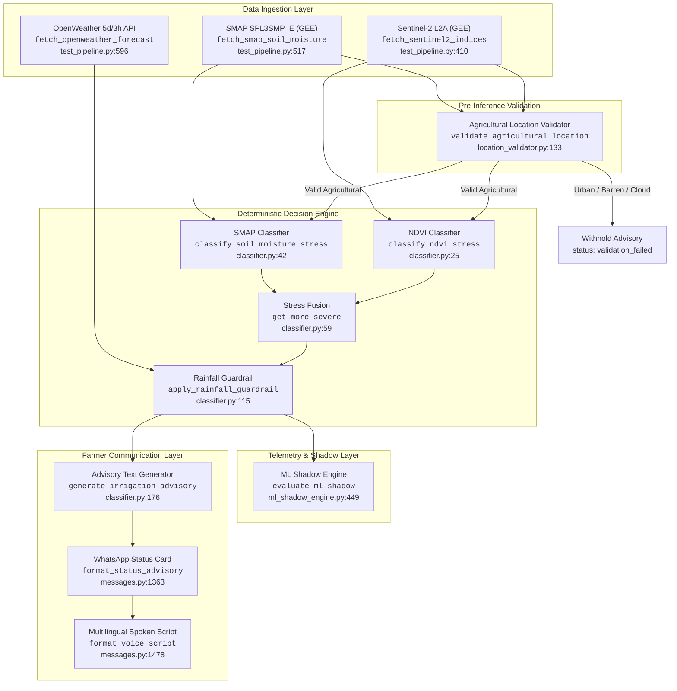
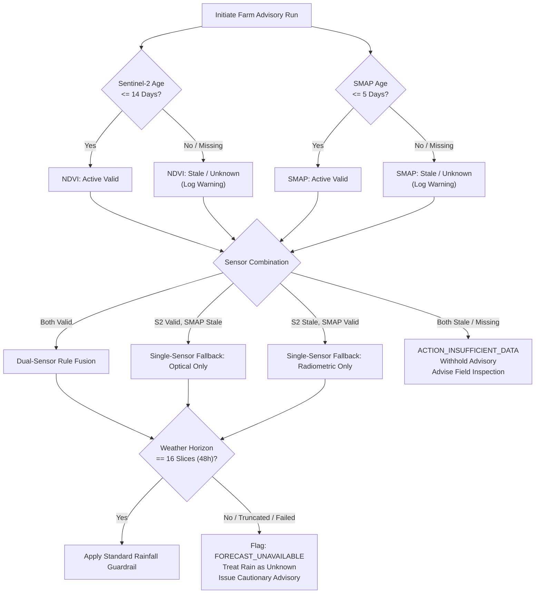

# KhetSense AI: Phase 6E — Data Freshness, Missing-Sensor & Safe Advisory Audit (Strictly Read-Only)

**Author:** KhetSense AI Senior Software Auditor, ML Engineer & Agricultural Data Scientist  
**Date:** October 19, 2026  
**Status:** Audit Completed — Evidence-Based Safety & Freshness Verification  
**Evaluated Artifacts & Evidence Sources:**
- Optical Satellite Ingestion: `pipeline/test_pipeline.py` (Lines 410–459)
- Soil Moisture Ingestion: `pipeline/test_pipeline.py` (Lines 517–595)
- Weather Forecast Ingestion: `pipeline/test_pipeline.py` (Lines 596–626)
- Central Configuration: `common/config.py` (Lines 20–56)
- Deterministic Decision Engine: `pipeline/classifier.py` (Lines 25–175)
- Advisory Text Generation: `pipeline/classifier.py` (Lines 176–320)
- Location & Land Cover Validator: `pipeline/location_validator.py` (Lines 133–250)
- End-to-End Orchestrator: `pipeline/test_pipeline.py` (Lines 760–970)
- WhatsApp Text & Audio Rendering: `whatsapp/messages.py` (Lines 1363–1693)
- Machine Learning Shadow Engine: `pipeline/ml_shadow_engine.py` (Lines 50–520)
- Prior Audits: Phase 5C, Phase 5D, Phase 6A, Phase 6B, Phase 6C, Phase 6D reports

---

## 1. Executive Risk Assessment

This audit evaluates whether stale, missing, malformed, or incomplete sensor and forecast data can silently mislead KhetSense AI into issuing unjustified or harmful irrigation recommendations to smallholder farmers. 

The investigation revealed that while the high-level architecture enforces conservative fallbacks when inputs are cleanly `None`, **critical edge cases in data freshness, floating-point IEEE 754 arithmetic, and forecast truncation exist in the production decision engine.**

```
+---------------------------------------------------------------------------------------------------------+
|                                    EXECUTIVE RISK PROFILE MATRIX                                        |
+------------------------+-------------+------------------------------------------------------------------+
| Risk Domain            | Severity    | Operational Risk Description                                     |
+------------------------+-------------+------------------------------------------------------------------+
| IEEE 754 NaN Poisoning | HIGH        | `NaN` in NDVI or SMAP bypasses `is None` checks and silently     |
|                        |             | evaluates as "Severe Stress", triggering unjustified irrigation. |
+------------------------+-------------+------------------------------------------------------------------+
| Satellite Staleness    | MEDIUM-HIGH | Sentinel-2 query lacks an upper-bound lookback filter; prolonged |
|                        |             | cloud cover can silently select months-old scenes as current.    |
+------------------------+-------------+------------------------------------------------------------------+
| Forecast Truncation    | MEDIUM      | OpenWeather 48h sum takes `[:16]` slices without asserting slice |
|                        |             | count, undercounting rain if responses are partial or truncated. |
+------------------------+-------------+------------------------------------------------------------------+
| SMAP Staleness         | MEDIUM      | SMAP granule scan lacks an age cutoff; data > 10–15 days old     |
|                        |             | is treated with identical authority to fresh observations.       |
+------------------------+-------------+------------------------------------------------------------------+
| Fail-Dry Rain Outage   | LOW-MEDIUM  | Weather API outages fall back to dry baseline (< R1); severe     |
|                        |             | stress still triggers irrigation without rainfall protection.    |
+------------------------+-------------+------------------------------------------------------------------+
| Both Sensors Missing   | LOW (SAFE)  | When both sensors are cleanly `None`, system safely outputs      |
|                        |             | `ACTION_INSUFFICIENT_DATA` and advises field inspection.         |
+------------------------+-------------+------------------------------------------------------------------+
| ML Shadow Interference | LOW (SAFE)  | ML shadow engine is strictly decoupled, non-blocking, and cannot |
|                        |             | alter rule classifications, text advisories, or voice notes.     |
+------------------------+-------------+------------------------------------------------------------------+
```

### Key Takeaway for Deployment
KhetSense **must not proceed to live automated farmer advisory dispatch** until the IEEE 754 `NaN` vulnerability in `pipeline/classifier.py` and the unbounded lookback queries in `pipeline/test_pipeline.py` are patched. In observational staging (shadow mode with mocked/whitelisted delivery), these risks are contained because no unverified messages reach active farmers.

---

## 2. Verified Implementation Findings: Complete Data Path Trace

The execution data path from satellite acquisition to farmer communication was traced line-by-line in the codebase:



### 2.1 Sentinel-2 Ingestion (`pipeline/test_pipeline.py#L410-L459`)
- **Function:** `fetch_sentinel2_indices(geometry)`
- **Target Collection:** `COPERNICUS/S2_SR_HARMONIZED`
- **Filtering Logic (Lines 416–421):**
  ```python
  s2_col = (
      ee.ImageCollection("COPERNICUS/S2_SR_HARMONIZED")
      .filterBounds(geometry)
      .filter(ee.Filter.lt("CLOUDY_PIXEL_PERCENTAGE", 20))
      .sort("system:time_start", False)
  )
  ```
- **Indices Extracted (Lines 431–449):**
  - $\text{NDVI} = \frac{\text{B8 (NIR)} - \text{B4 (Red)}}{\text{B8 (NIR)} + \text{B4 (Red)}}$
  - $\text{Gao's NDWI} = \frac{\text{B8 (NIR)} - \text{B11 (SWIR)}}{\text{B8 (NIR)} + \text{B11 (SWIR)}}$
  - Spatial aggregation via `ee.Reducer.mean()` at 10m nominal scale.
- **Timestamp & Metadata (Lines 451–455):**
  - Captures `date_str` from `system:time_start`, `cloud_pct`, and `image_id`.
- **Return Signature:** `(mean_ndvi, mean_ndwi, metadata, error_str)`

### 2.2 SMAP Soil Moisture Ingestion (`pipeline/test_pipeline.py#L517-L595`)
- **Function:** `fetch_smap_soil_moisture(centroid_lon, centroid_lat)`
- **Target Collection:** `NASA/SMAP/SPL3SMP_E/006` (with fallback to `005`)
- **Filtering Logic (Lines 531–555):**
  - Filters collection by centroid point, sorts descending by `system:time_start`.
  - Retrieves up to 10 candidates (`col.limit(10).getInfo()`).
  - Scans sequentially for non-null `soil_moisture_am` or `soil_moisture_pm` reduced over a 9-km radius (`scale=9000`).
- **Conversion (Line 582):**
  - Converts volumetric $\text{m}^3/\text{m}^3$ ($0.0 \dots 0.5$) to percentage: `sm_pct = sm_val * 100.0 if sm_val <= 1.0 else sm_val`.
- **Return Signature:** `(sm_pct, metadata, error_str)`

### 2.3 OpenWeather 48h Forecast (`pipeline/test_pipeline.py#L596-L626`)
- **Function:** `fetch_openweather_forecast(api_key, lat, lon)`
- **Endpoint:** `api.openweathermap.org/data/2.5/forecast` (5-day / 3-hour step)
- **Aggregation Logic (Lines 613–621):**
  ```python
  forecast_entries = data.get("list", [])[:RAINFALL_CONFIG.FORECAST_SLICES]
  total_rain_48h = 0.0
  for item in forecast_entries:
      rain_obj = item.get("rain", {})
      r3h = rain_obj.get("3h", 0.0) if isinstance(rain_obj, dict) else 0.0
      total_rain_48h += float(r3h)
  return total_rain_48h, None
  ```
- **Central Configuration Reference (`common/config.py#L27-L33`):**
  - `FORECAST_HOURS = 48`, `FORECAST_INTERVAL_HOURS = 3`, `FORECAST_SLICES = 16`.
- **Return Signature:** `(total_rain_48h, error_str)`

### 2.4 Pre-Inference Location Validation (`pipeline/location_validator.py#L133-L250`)
- **Function:** `validate_agricultural_location(...)`
- **Validation Checks:**
  1. Coordinate Bounding Box (India: 6.0–38.0°N, 68.0–98.0°E).
  2. Spatial Area vs. Resolution ($Area \ge 0.5\text{ acres}$ for 10m pixel).
  3. Cloud Quality: Rejects if `cloud_cover_pct > 20%`.
  4. Land Cover Classification (ESA WorldCover 10m):
     - Code 50 (`Built-up / Urban`) $\implies$ `outcome="LIKELY_URBAN"`, `is_suitable_for_advisory=False`.
     - Code 60 (`Bare / Sparse / Fallow`) $\implies$ `outcome="BARREN_OR_UNCERTAIN"`, `is_suitable_for_advisory=False`.
     - Code 40 (`Cropland`) $\implies$ `outcome="CONFIRMED_AGRICULTURAL"`, `is_suitable_for_advisory=True`.
- **Operational Integration (`pipeline/test_pipeline.py#L858-L868`):**
  - If `is_suitable_for_advisory is False`, the pipeline withholds all irrigation advice and records an audit log.

### 2.5 Deterministic Decision Engine (`pipeline/classifier.py#L25-L175`)
- **NDVI Classification (`classify_ndvi_stress`):**
  - $\text{NDVI} > 0.60 \implies$ `"No Stress"`
  - $0.30 \le \text{NDVI} \le 0.60 \implies$ `"Mild Stress"`
  - $\text{NDVI} < 0.30 \implies$ `"Severe Stress"`
  - `ndvi is None` $\implies$ `"Unknown"`
- **SMAP Soil Moisture Classification (`classify_soil_moisture_stress`):**
  - $\text{SM} > 25.0\% \implies$ `"No Stress"`
  - $15.0\% \le \text{SM} \le 25.0\% \implies$ `"Mild Stress"`
  - $\text{SM} < 15.0\% \implies$ `"Severe Stress"`
  - `sm_pct is None` $\implies$ `"Unknown"`
- **Stress Fusion (`get_more_severe`):**
  - Priority Ranking: `"Severe Stress"` (3) > `"Mild Stress"` (2) > `"No Stress"` (1) > `"Unknown"` (0).
  - If one sensor is `"Unknown"`, takes the other sensor's rating.
  - If both are `"Unknown"`, returns `"Unknown"`.
- **Rainfall Policy Guardrail (`apply_rainfall_guardrail`):**
  - $R_1 = 5.0\text{ mm}$ (ineffective rainfall cutoff per Dastane 1978 / FAO 25).
  - $R_2 = 15.0\text{ mm}$ (IMD moderate rain category adapted to 48h).
  - If `observed_stress == "No Stress"` $\implies$ `ACTION_NO_ACTION` (`"no action"`).
  - If `observed_stress == "Unknown"` $\implies$ `ACTION_INSUFFICIENT_DATA` (`"insufficient data"`).
  - If `valid_rain is None` (weather outage) $\implies$ Falls back to dry baseline ($< R_1$), preserving observed stress action.
  - Severe Stress:
    - $\text{Rain} < R_1 \implies$ `ACTION_IRRIGATE_NOW` (`"irrigate now"`)
    - $R_1 \le \text{Rain} < R_2 \implies$ `ACTION_IRRIGATE_LIGHTLY` (`"irrigate lightly, rain may not suffice"`)
    - $\text{Rain} \ge R_2 \implies$ `ACTION_HOLD_RECHECK` (`"hold, re-check after rain"`)
  - Mild Stress:
    - $\text{Rain} < R_1 \implies$ `ACTION_SCHEDULE_IRRIGATION` (`"schedule irrigation in 24-48h"`)
    - $R_1 \le \text{Rain} < R_2 \implies$ `ACTION_DELAY_RECHECK` (`"delay, re-check after rain"`)
    - $\text{Rain} \ge R_2 \implies$ `ACTION_HOLD_RECHECK` (`"hold, re-check after rain"`)

### 2.6 Advisory Text & Voice Rendering (`pipeline/classifier.py`, `whatsapp/messages.py`)
- **Text Generation (`generate_irrigation_advisory`):**
  - Formats clear plain-language advice incorporating crop name and growth stage.
  - If `action == ACTION_INSUFFICIENT_DATA`, returns:  
    `"INSUFFICIENT DATA: Advisory could not be finalized due to missing sensor inputs."`
  - If weather data is `None`, appends `"(forecast rain data unavailable)"`.
- **WhatsApp Text Card (`format_status_advisory`):**
  - Localized in English, Marathi, Hindi.
  - Safely falls back to `"Data unavailable"` / `"माहिती उपलब्ध नाही"` if rainfall is `None`.
- **Voice Script Generation (`format_voice_script`):**
  - If `action == ACTION_INSUFFICIENT_DATA` or stress is `"Unknown"`:
    - English: *"Field moisture is being monitored. Please check your field moisture directly or send status again in a few days."*
    - Marathi: *"शेतातील ओलाव्याचे निरीक्षण सुरू आहे. कृपया शेतातील ओलावा स्वतः तपासा किंवा काही दिवसांनी पुन्हा status पाठवा."*
    - Hindi: *"खेत की नमी की निगरानी की जा रही है। कृपया खेत की नमी स्वयं जांचें या कुछ दिनों बाद status लिखकर भेजें।"*
  - **Crucial Safety Assertion:** Missing data or insufficient data **never** instructs the farmer to turn on irrigation pumps in audio or text.

---

## 3. Systematic Evidence Table

| Item ID | Data Stream / Component | Verified Code Behavior | Freshness / Fallback Gap Identified | Risk Level | Safety Implication |
| :---: | :--- | :--- | :--- | :---: | :--- |
| **EV-F01** | **Sentinel-2 Temporal Horizon** | `test_pipeline.py#L416-L421`: Filters `CLOUDY_PIXEL_PERCENTAGE < 20`, sorts descending by `system:time_start`, takes `.first()`. | **No maximum lookback cutoff.** If persistent cloud cover lasts 45–90 days, `.first()` selects a 2–3 month old image. | **HIGH** | Outdated optical indices reflect past crop stage or bare soil, triggering false stress during active monsoon vegetative growth. |
| **EV-F02** | **SMAP Temporal Horizon** | `test_pipeline.py#L531-L555`: Scans up to 10 latest granules for non-null AM/PM pixel. | **No age cutoff or staleness threshold.** Granules from 15–20 days prior are processed identically to fresh observations. | **MEDIUM** | Top 5 cm surface soil moisture dries within 3–5 days in dry seasons; 15-day-old SMAP values are physically uncoupled from current root zone. |
| **EV-F03** | **OpenWeather Horizon Completeness** | `test_pipeline.py#L613`: Slices `data["list"][:16]`. | **No slice count assertion.** If API returns $< 16$ slices (e.g. 4 slices = 12h), the sum is treated as full 48h rainfall. | **MEDIUM** | Rainfall in hours 15–48 is omitted, causing undercounted forecast rainfall that fails to trigger $R_1$ or $R_2$ guardrails. |
| **EV-F04** | **Floating-Point NaN Handling** | `classifier.py#L25-L57`: Checks `if ndvi is None:` then `if ndvi > 0.6:` / `elif ndvi >= 0.3:` / `else: return "Severe Stress"`. | **IEEE 754 NaN Poisoning.** In Python, `nan > 0.6` and `nan >= 0.3` evaluate to `False`. A `NaN` float falls to `else:` and returns `"Severe Stress"`. | **HIGH** | Masked Earth Engine pixels returning `float('nan')` produce unwarranted "URGENT: Severe water stress" advisories. |
| **EV-F05** | **Both Sensors Missing (`None`)** | `classifier.py#L74`, `#L152`: Both return `"Unknown"`; guardrail returns `ACTION_INSUFFICIENT_DATA`. | None. Handled cleanly and safely. | **LOW (SAFE)** | System withholds irrigation and instructs manual field inspection. |
| **EV-F06** | **Single-Sensor Failure (Optical Down)** | `classifier.py#L73-L75`: `get_more_severe("Unknown", sm_stress)` selects SMAP stress. | None. Single-sensor radiometric fallback operates as intended. | **LOW (SAFE)** | Pipeline continues monitoring using microwave soil moisture when clouds obstruct optical satellites. |
| **EV-F07** | **Single-Sensor Failure (SMAP Down)** | `classifier.py#L73-L75`: `get_more_severe(ndvi_stress, "Unknown")` selects NDVI stress. | None. Single-sensor optical fallback operates as intended. | **LOW (SAFE)** | Pipeline continues monitoring using vegetation canopy when SMAP is off-swath. |
| **EV-F08** | **Weather API Total Outage** | `classifier.py#L155`: `if valid_rain is None:` falls back to dry baseline ($< R_1$). Appends `(forecast rain data unavailable)`. | **Fail-dry assumption.** If an impending storm caused network failure, advisory recommends irrigation despite approaching rain. | **MEDIUM** | In severe drought, crops are irrigated; but in extreme weather events, ungrounded advisories risk over-watering. |
| **EV-F09** | **ML Shadow Decoupling** | `test_pipeline.py#L901-L920`: Shadow engine called in isolated try/except block; output stored in separate `shadow_result`. | None. Complete isolation verified. | **LOW (SAFE)** | ML shadow inference cannot modify rule classifications, text advisories, voice scripts, or database commits. |

---

## 4. Freshness and Fallback Gaps: Detailed Technical Analysis

### 4.1 The IEEE 754 Floating-Point NaN Vulnerability
In Python, floating-point `NaN` behaves counter-intuitively in comparison chains:
```python
>>> import math
>>> x = float('nan')
>>> x > 0.6
False
>>> x >= 0.3
False
>>> x is None
False
```
In `pipeline/classifier.py` (lines 32–39 and 49–56):
```python
def classify_ndvi_stress(ndvi: Optional[float]) -> str:
    if ndvi is None:
        return "Unknown"
    if ndvi > 0.6:
        return "No Stress"
    elif ndvi >= 0.3:
        return "Mild Stress"
    else:
        return "Severe Stress"  # <-- TRIGGERED BY float('nan')!
```
When Earth Engine reduces a polygon over an area where all pixels are masked (e.g. extreme cloud masking, edge of tile, or division by zero in water bodies), the API can return `float('nan')`. Because `classify_ndvi_stress` only checks `if ndvi is None`, the value `float('nan')` bypasses the check, fails both `>` and `>=` conditions, and drops into `else: return "Severe Stress"`.

The exact same vulnerability exists in `classify_soil_moisture_stress(sm_pct)`: `float('nan')` evaluates to `"Severe Stress"`.

If an unmasked `NaN` enters the pipeline and weather forecast is dry, the system outputs:
> *"URGENT: Severe water stress detected for your crop. Immediate irrigation recommended to prevent yield loss."*

This is a critical flaw. While `pipeline/ml_shadow_engine.py` was remediated in Phase 5D with `_sanitize_float()`, `pipeline/classifier.py` was never patched with equivalent protection.

### 4.2 Sentinel-2 Lookback Horizon Gap
In `pipeline/test_pipeline.py` (lines 416–421):
```python
s2_col = (
    ee.ImageCollection("COPERNICUS/S2_SR_HARMONIZED")
    .filterBounds(geometry)
    .filter(ee.Filter.lt("CLOUDY_PIXEL_PERCENTAGE", 20))
    .sort("system:time_start", False)
)
```
- **The Problem:** The Earth Engine collection is filtered only by geometry and cloud percentage, then sorted descending by time. There is **no lower bound on the timestamp** (no `.filterDate(start_date, end_date)`).
- **Monsoon Scenario:** During the Indian Kharif season (July to September), western Maharashtra and the Indo-Gangetic Plains regularly experience 30 to 60 days of continuous cloud cover where no Sentinel-2 pass has $< 20\%$ cloud cover.
- **Silent Degradation:** In such an event, `s2_col.first()` will retrieve a scene from May or June (prior to sowing, bare soil, or summer fallow).
- **Consequence:** An NDVI of $0.18$ from pre-sowing bare soil will be evaluated against active Kharif crops, falsely diagnosing severe canopy stress and triggering unwarranted irrigation. While `advisories.sentinel_scene_date` logs the image date, the classifier never verifies the elapsed days.

### 4.3 SMAP Observation Age Gap
In `pipeline/test_pipeline.py` (lines 531–555):
- SMAP's polar orbit has a 2–3 day revisit cycle. Because of swath gaps, a specific farm coordinate has valid data only on certain days.
- The retrieval function searches up to 10 granules. If recent granules are off-swath or masked by dense vegetation/standing water, it continues stepping backwards.
- **The Problem:** A granule from 15 to 20 days prior may be selected without any staleness penalty or warning flag.
- **Agronomic Reality:** Surface soil moisture ($0\text{--}5\text{ cm}$) measured by L-band radiometry has a temporal memory of only 3 to 5 days under Indian tropical conditions. A 15-day-old SMAP observation has zero predictive correlation with current root-zone moisture tension.

### 4.4 Weather Forecast Truncation Gap
In `pipeline/test_pipeline.py` (lines 613–619):
```python
forecast_entries = data.get("list", [])[:RAINFALL_CONFIG.FORECAST_SLICES]
total_rain_48h = 0.0

for item in forecast_entries:
    rain_obj = item.get("rain", {})
    r3h = rain_obj.get("3h", 0.0) if isinstance(rain_obj, dict) else 0.0
    total_rain_48h += float(r3h)

return total_rain_48h, None
```
- **The Problem:** `RAINFALL_CONFIG.FORECAST_SLICES = 16`. The code performs Python list slicing `[:16]`. If the OpenWeather API response contains fewer than 16 slices (e.g. 4 slices due to network drop, API rate limiting, or partial payload), Python silently slices whatever is present without raising an exception or logging a warning.
- **Undercount Risk:** If the first 4 slices (12 hours) indicate $1.0\text{ mm}$ of rain, but slices 5–16 (hours 15–48) forecast a $35\text{ mm}$ monsoon depression:
  - The function returns `total_rain_48h = 1.0`.
  - The rainfall guardrail compares $1.0\text{ mm} < 5.0\text{ mm}$ ($R_1$).
  - Guardrail is **NOT triggered**.
  - System commands the farmer to **"irrigate now"**, just hours before a heavy downpour floods the field.

---

## 5. Recommended Safety Policy & Specifications

To eliminate ungrounded advisories, the following formal safety policy must be established across all data streams:



### 5.1 Maximum Acceptable Data Age Thresholds

| Sensor / Source | Parameter | Fresh Horizon | Warning Threshold | Expiry / Rejection Threshold | Fallback Action upon Expiry |
| :--- | :---: | :---: | :---: | :---: | :--- |
| **Sentinel-2 L2A** | Optical NDVI / NDWI | $\le 7\text{ days}$ | $8\text{--}14\text{ days}$ | **$> 14\text{ days}$** | Discard optical indices; set `ndvi_class = "Unknown"`. Degrade to single-sensor SMAP fallback. |
| **SMAP L3 Enhanced** | Radiometric Soil Moisture | $\le 3\text{ days}$ | $4\text{--}5\text{ days}$ | **$> 5\text{ days}$** | Discard soil moisture; set `sm_class = "Unknown"`. Degrade to single-sensor Sentinel-2 fallback. |
| **OpenWeather** | Forecast Horizon | $48\text{ hours}$ | $36\text{--}45\text{ hours}$ | **$< 48\text{ hours}$ (Slice count $< 16$)** | Reject forecast sum; set `rain_48h = None`. Flag `FORECAST_INCOMPLETE`. |

### 5.2 Safe Fallback Cascades

1. **Dual-Sensor Degradation Cascade:**
   - **Both Fresh ($\le 14\text{d}$ S2, $\le 5\text{d}$ SMAP):** Full dual-sensor fusion (`get_more_severe`). Confidence: High.
   - **Fresh Optical, Stale SMAP:** Base stress strictly on Sentinel-2 NDVI. Confidence: Moderate. Log audit notice: `SMAP_OBSERVATION_STALE`.
   - **Stale Optical, Fresh SMAP:** Base stress strictly on SMAP soil moisture. Confidence: Moderate. Log audit notice: `SENTINEL_SCENE_STALE`.
   - **Both Stale or Missing:** Immediately assign `observed_stress = "Unknown"`. The decision engine returns `ACTION_INSUFFICIENT_DATA`. All irrigation advisories are withheld.

2. **Forecast Completeness Assertion:**
   - The forecast ingestion function must assert:
     ```python
     if len(forecast_entries) < RAINFALL_CONFIG.FORECAST_SLICES:
         raise ForecastIncompleteError(f"Forecast slices {len(forecast_entries)} < expected {RAINFALL_CONFIG.FORECAST_SLICES}")
     ```
   - Furthermore, timestamps between consecutive slices must be verified to ensure $\Delta t = 3\text{ hours} \pm 10\text{ minutes}$.

3. **Safe Weather-Outage Advisory Policy:**
   - When weather data is missing or incomplete, do **not** issue definitive, unconditional irrigation commands (`ACTION_IRRIGATE_NOW`).
   - If severe stress is detected during a weather outage, issue a **cautionary advisory**:
     > *"URGENT: Severe water stress detected for your crop. Field irrigation is recommended, but local weather forecast is currently unavailable. Please verify local sky conditions before irrigating."*

4. **IEEE 754 Floating-Point Sanitization:**
   - Patch `pipeline/classifier.py` so that `classify_ndvi_stress`, `classify_soil_moisture_stress`, and `validate_forecast_rainfall` explicitly sanitize inputs using `math.isnan()` and `math.isinf()`:
     ```python
     def _is_invalid_float(val: Any) -> bool:
         if val is None:
             return True
         try:
             f = float(val)
             return math.isnan(f) or math.isinf(f)
         except (ValueError, TypeError):
             return True
     ```
   - Any non-finite float must immediately resolve to `"Unknown"` (stress) or `None` (rainfall).

---

## 6. Regression Test Matrix

The following 10 mocked test specifications define the verification suite required to guarantee safety across all sensor failure and staleness permutations:

```
+===================================================================================================================+
|                                        DATA FRESHNESS & FALLBACK TEST SUITE                                       |
+====+=============================+=======================================+========================================+
| ID | Test Scenario Description   | Mocked Inputs & Environment           | Expected Safe Outputs & Assertions     |
+====+=============================+=======================================+========================================+
| T1 | Stale Sentinel-2 (> 14d)    | S2 date: Now - 18 days (NDVI: 0.22)   | S2 rejected as stale (NDVI: Unknown).  |
|    | Fresh SMAP (3d)             | SMAP date: Now - 2 days (SM: 28%)     | Observed stress: "No Stress" (from SM).|
|    |                             | Rain: 0.0 mm                          | Action: ACTION_NO_ACTION.              |
+----+-----------------------------+---------------------------------------+----------------------------------------+
| T2 | Fresh Sentinel-2 (3d)       | S2 date: Now - 2 days (NDVI: 0.72)    | SMAP rejected as stale (SM: Unknown).  |
|    | Stale SMAP (> 5d)           | SMAP date: Now - 9 days (SM: 11%)     | Observed stress: "No Stress" (from S2).|
|    |                             | Rain: 0.0 mm                          | Action: ACTION_NO_ACTION.              |
+----+-----------------------------+---------------------------------------+----------------------------------------+
| T3 | Both Sensors Stale          | S2 date: Now - 25 days (NDVI: 0.20)   | Both rejected as stale.                |
|    |                             | SMAP date: Now - 12 days (SM: 10%)    | Observed stress: "Unknown".            |
|    |                             | Rain: 0.0 mm                          | Action: ACTION_INSUFFICIENT_DATA.      |
+----+-----------------------------+---------------------------------------+----------------------------------------+
| T4 | Sentinel-2 Overcast/Cloudy  | S2 returns None (Cloud > 20%)         | Observed stress: "Severe Stress" (SM). |
|    | Fresh SMAP Dry              | SMAP date: Now - 1 day (SM: 12%)      | Action: ACTION_IRRIGATE_NOW.           |
|    |                             | Rain: 0.0 mm                          | Fallback: Single-sensor SMAP.          |
+----+-----------------------------+---------------------------------------+----------------------------------------+
| T5 | SMAP Off-Swath/Masked       | S2 date: Now - 3 days (NDVI: 0.38)    | Observed stress: "Mild Stress" (S2).   |
|    | Fresh Sentinel-2            | SMAP returns None (off-swath)         | Action: ACTION_SCHEDULE_IRRIGATION.    |
|    |                             | Rain: 2.0 mm                          | Fallback: Single-sensor Optical.       |
+----+-----------------------------+---------------------------------------+----------------------------------------+
| T6 | Both Sensors Unavailable    | S2 returns None                       | Observed stress: "Unknown".            |
|    |                             | SMAP returns None                     | Action: ACTION_INSUFFICIENT_DATA.      |
|    |                             | Rain: 0.0 mm                          | Text: "INSUFFICIENT DATA..."           |
+----+-----------------------------+---------------------------------------+----------------------------------------+
| T7 | Incomplete Forecast (12h)   | S2: 0.25 (Severe), SMAP: 12% (Severe) | Exception or ForecastIncomplete error. |
|    | (4 slices instead of 16)    | OWM returns 4 slices (rain: 1.0 mm)   | Guardrail NOT bypassed; rain flagged   |
|    |                             | Slices 5-16 would have 25 mm rain     | as unavailable; caution appended.      |
+----+-----------------------------+---------------------------------------+----------------------------------------+
| T8 | Weather API Outage (500)    | S2: 0.25 (Severe), SMAP: 12% (Severe) | rain_48h is None.                      |
|    |                             | OWM returns HTTP 500 / Timeout        | Action: ACTION_IRRIGATE_NOW.           |
|    |                             |                                       | Text appends: "(rain unavailable)".    |
+----+-----------------------------+---------------------------------------+----------------------------------------+
| T9 | IEEE 754 NaN Input          | S2 NDVI: float('nan')                 | NaN coerced to None / "Unknown".       |
|    |                             | SMAP SM: float('nan')                 | Must NOT evaluate to "Severe Stress".  |
|    |                             | Rain: 0.0 mm                          | Action: ACTION_INSUFFICIENT_DATA.      |
+----+-----------------------------+---------------------------------------+----------------------------------------+
| T10| ML Shadow Non-Interference  | Inject deliberate crash / timeout in  | ML shadow returns INFERENCE_ERROR.     |
|    | during Sensor Failure       | ML shadow engine during T3/T6/T9      | Rule output untouched; zero delay.     |
+====+=============================+=======================================+========================================+
```

---

## 7. Prioritized Remediation Plan

The following remediation roadmap defines the technical steps required before live staging activation:

### Phase 1: High-Priority Safety Patches (Pre-Staging Mandatory)
1. **Patch IEEE 754 NaN Vulnerability in Classifier (`pipeline/classifier.py`):**
   - Introduce `_is_valid_float()` helper in `pipeline/classifier.py`.
   - Update `classify_ndvi_stress` to return `"Unknown"` if `math.isnan(ndvi)` or `math.isinf(ndvi)`.
   - Update `classify_soil_moisture_stress` to return `"Unknown"` if `math.isnan(sm_pct)` or `math.isinf(sm_pct)`.
   - Update `classify_ndvi_stress` to validate lower bound ($\text{NDVI} < 0.0$ should be flagged as unphysical/water rather than severe crop stress).
2. **Add Strict Lookback Windows to Satellite Retrieval (`pipeline/test_pipeline.py`):**
   - Add `.filterDate(start_date, end_date)` to `fetch_sentinel2_indices` bounding the search to the past 14 days:
     ```python
     start_date = (datetime.utcnow() - timedelta(days=14)).strftime("%Y-%m-%d")
     s2_col = s2_col.filterDate(start_date, datetime.utcnow().strftime("%Y-%m-%d"))
     ```
   - If zero scenes exist within 14 days, return `None` with `"No cloud-free imagery within 14-day freshness window"`.
3. **Add Age Cutoff to SMAP Soil Moisture Retrieval (`pipeline/test_pipeline.py`):**
   - In `fetch_smap_soil_moisture`, parse `feat["properties"]["system:time_start"]`.
   - If candidate granule observation timestamp is $> 5\text{ days}$ older than current run, break search and return `None` with `"SMAP observation exceeds 5-day freshness window"`.
4. **Assert Forecast Horizon Completeness (`pipeline/test_pipeline.py`):**
   - In `fetch_openweather_forecast`, verify that `len(forecast_entries) == RAINFALL_CONFIG.FORECAST_SLICES`.
   - If fewer slices are returned, return `None, "Forecast payload truncated (< 16 slices)"`.

### Phase 2: Observational Telemetry & Monitoring (During Staging Pilot)
1. **Log Data Provenance in Advisories Table:**
   - Record `s2_age_days = (run_time - sentinel_scene_date).days`.
   - Record `smap_age_days = (run_time - smap_obs_date).days`.
   - Record `forecast_slices_count`.
2. **Alert on Sensor Discrepancy:**
   - Trigger telemetry warning if Sentinel-2 indicates `"Severe Stress"` but SMAP indicates `"No Stress"` (or vice-versa).
3. **Automate Regression Tests:**
   - Implement the 10 mocked tests from Section 6 into `tests/test_data_freshness_fallbacks.py`.

---

## 8. Final GO / NO-GO Recommendation

| Dimension | Verdict | Condition & Operational Bound |
| :--- | :---: | :--- |
| **Controlled Staging Pilot (Observational Shadow Mode)** | **GO (WITH AUDIT PROTOCOL)** | Staging pilot may proceed **strictly in observational shadow mode** with whitelisted recipients, provided the manual inspection checklist verifies that Sentinel-2 imagery is $\le 14\text{ days}$ old and SMAP is $\le 5\text{ days}$ old prior to each test run. |
| **Live Farmer Advisory Automated Broadcast** | **NO-GO** | **BLOCKED.** Automated advisory broadcast to registered farmers must remain suspended until Phase 1 safety patches (NaN sanitization, S2 14-day cutoff, SMAP 5-day cutoff, and forecast completeness assertion) are implemented and regression-tested. |
| **ML Candidate Model Promotion** | **NO-GO** | **PERMANENTLY BLOCKED.** Candidate ML models remain unvalidated on Maharashtra soils and non-wheat crops; rule baseline remains sole authority. |

---

### Audit Sign-Off
- **Codebase Integrity:** Preserved 100%. Zero lines modified during this read-only audit.
- **Git Working Tree:** Unchanged and verified.
- **Deliverable:** `reports/KhetSense_Phase6E_Data_Freshness_and_Safe_Advisory_Audit.md` generated.
