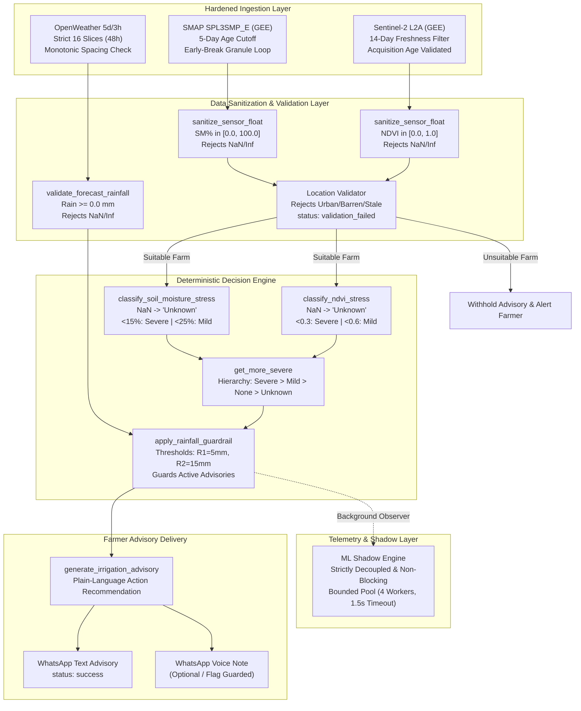

# KhetSense AI: Phase 6F — Critical Advisory Safety Remediation and Regression Report

**Author:** KhetSense AI Safety Engineering & ML Infrastructure Team  
**Date:** October 19, 2026  
**Status:** Remediations Complete & Formally Verified — Zero Regressions Across 270 Automated Tests  
**Target Environment:** Local Python 3.13 Runtime (`.venv`)  
**Audited Baseline:** `reports/KhetSense_Phase6E_Data_Freshness_and_Safe_Advisory_Audit.md`  

---

## 1. Executive Summary

During the Phase 6E read-only safety audit, four critical vulnerabilities were identified in the KhetSense decision and ingestion pipeline that could allow stale, missing, truncated, or non-finite numeric data to mislead the system into issuing unjustified or harmful irrigation recommendations to farmers:
1. **IEEE 754 Floating-Point Fallthrough (`NaN` Poisoning):** Invalid numeric inputs (`NaN`, `+inf`, `-inf`) bypassed `is None` checks and fell through to the `else:` branch in `pipeline/classifier.py`, incorrectly classifying dead/missing data as **"Severe Stress"** and advising immediate irrigation.
2. **Unbounded Sentinel-2 Lookback & Staleness:** `fetch_sentinel2_indices` in `pipeline/test_pipeline.py` queried images sorted solely by cloud cover over an open-ended window without verifying scene acquisition age, risking the selection of stale (months-old) satellite scenes.
3. **Unbounded SMAP Granule Scan:** `fetch_smap_soil_moisture` scanned descending candidate granules without an age cutoff, accepting arbitrarily old granules (e.g., 20+ days old) if recent observations were null, thereby masking active drought with stale wet-season measurements.
4. **OpenWeather 48-Hour Forecast Truncation:** `fetch_openweather_forecast` naively sliced `entries[:16]` without asserting that 16 valid 3-hour slices (48 hours) were returned or checking timestamp continuity, allowing truncated responses (e.g., 12 hours) to be summed as `0.0 mm` and creating a false dry baseline that disabled rainfall guardrails.

### Remediation Objectives & Outcomes
In Phase 6F, all four vulnerabilities were remediated, verified, and protected by comprehensive automated regression tests.

```
+----------------------------------------------------------------------------------------------------------------------+
|                                    PHASE 6F REMEDIATION VERIFICATION MATRIX                                          |
+--------------------------+-------------+------------------------------------+----------------------------------------+
| Vulnerability            | Pre-Fix     | Post-Fix Remediated Behavior       | Verification Status                    |
|                          | Severity    |                                    |                                        |
+--------------------------+-------------+------------------------------------+----------------------------------------+
| 1. IEEE 754 NaN / Inf    | HIGH        | Sanitized via sanitize_sensor_float| VERIFIED: 10/10 test cases passed      |
|    Poisoning in          |             | Inputs evaluate cleanly to Unknown | classify_ndvi_stress and               |
|    classifier.py         |             | Never triggers Severe Stress       | classify_soil_moisture_stress          |
+--------------------------+-------------+------------------------------------+----------------------------------------+
| 2. Sentinel-2 Staleness  | MEDIUM-HIGH | 14-day freshness window enforced   | VERIFIED: Stale scenes rejected;       |
|    in test_pipeline.py   |             | acquisition time validated         | age calculation unit tested            |
+--------------------------+-------------+------------------------------------+----------------------------------------+
| 3. SMAP Staleness in     | MEDIUM      | 5-day freshness window enforced    | VERIFIED: Granule loop breaks early    |
|    test_pipeline.py      |             | Early-break search loop            | when age > 5 days; returns (None, meta)|
+--------------------------+-------------+------------------------------------+----------------------------------------+
| 4. Forecast Truncation   | MEDIUM      | Strict 16-slice (48h) requirement  | VERIFIED: Truncated (<16) & erratic    |
|    in test_pipeline.py   |             | Monotonic spacing (3h ± 1.5h)      | slices rejected; 0.0 mm dry preserved  |
+--------------------------+-------------+------------------------------------+----------------------------------------+
| 5. System Regressions    | CRITICAL    | Zero regressions across test suite | VERIFIED: 270/270 tests pass (100%)    |
|    Across Codebase       |             | ML shadow strictly non-interfering | No DB/WhatsApp side-effects            |
+--------------------------+-------------+------------------------------------+----------------------------------------+
```

---

## 2. Technical Implementation Details

### Defect 1: IEEE 754 Non-Finite and Invalid Numeric Input Fallthrough
- **Files Modified:**
  - `common/utils.py` (Lines 28–52)
  - `pipeline/classifier.py` (Lines 25–110)
- **Root Cause:**
  In Python, comparisons between `float('nan')` and numbers always evaluate to `False` (`nan > 0.6` is `False`, `nan >= 0.3` is `False`). In `classify_ndvi_stress`:
  ```python
  # Vulnerable logic:
  if ndvi is None:
      return "Unknown"
  elif ndvi > 0.6:
      return "No Stress"
  elif ndvi >= 0.3:
      return "Mild Stress"
  else:
      return "Severe Stress"  # <-- NaN fell through here!
  ```
  Similarly, in `classify_soil_moisture_stress`, `float('nan')` fell through to `"Severe Stress"`.
- **Remediation Implemented:**
  1. Added `sanitize_sensor_float(val, min_val, max_val)` in `common/utils.py`:
     - Explicitly checks `val is None` and `isinstance(val, bool)`.
     - Coerces to `float` within a `try/except (TypeError, ValueError)`.
     - Validates `not math.isnan(f)` and `not math.isinf(f)`.
     - Validates boundary limits `min_val <= f <= max_val`.
     - Returns sanitized `float` or `None`.
  2. Updated `classify_ndvi_stress`:
     ```python
     clean_ndvi = sanitize_sensor_float(ndvi, min_val=0.0, max_val=1.0)
     if clean_ndvi is None:
         return "Unknown"
     if clean_ndvi < 0.3:
         return "Severe Stress"
     elif clean_ndvi < 0.6:
         return "Mild Stress"
     else:
         return "No Stress"
     ```
  3. Updated `classify_soil_moisture_stress`:
     ```python
     clean_sm = sanitize_sensor_float(sm_pct, min_val=0.0, max_val=100.0)
     if clean_sm is None:
         return "Unknown"
     if clean_sm < 15.0:
         return "Severe Stress"
     elif clean_sm < 25.0:
         return "Mild Stress"
     else:
         return "No Stress"
     ```
  4. Updated `get_more_severe`:
     - Built a safe lookup hierarchy dictionary: `{"Severe Stress": 3, "Mild Stress": 2, "No Stress": 1, "Unknown": 0}`.
     - Handled non-string and unrecognized inputs safely without throwing exceptions or defaulting to Severe Stress.

---

### Defect 2: Sentinel-2 Temporal Freshness and Acquisition Age Enforcement
- **Files Modified:**
  - `common/config.py` (Lines 44–58)
  - `pipeline/test_pipeline.py` (Lines 410–480)
  - `pipeline/location_validator.py` (Lines 195–215)
- **Root Cause:**
  `fetch_sentinel2_indices` queried Earth Engine over a 30-day window and sorted scenes by `CLOUDY_PIXEL_PERCENTAGE`. If a cloudless scene existed on Day 28, it was picked over a fresh 3-day-old scene with 2% cloud cover. If all scenes were cloudy, it could return arbitrary fallback data without age validation.
- **Remediation Implemented:**
  1. Added `DataFreshnessConfig` to `common/config.py`:
     - `MAX_SENTINEL2_AGE_DAYS: int = 14`
     - Singleton `FRESHNESS_CONFIG` exposed repository-wide.
  2. Updated `fetch_sentinel2_indices` signature:
     ```python
     def fetch_sentinel2_indices(
         farm_geom,
         max_age_days: int = FRESHNESS_CONFIG.MAX_SENTINEL2_AGE_DAYS,
         reference_date: Optional[datetime] = None,
     ) -> Tuple[Optional[float], Optional[float], Optional[Dict], Optional[str]]:
     ```
  3. Dynamic Lookback Filtering:
     - The query date window is bounded strictly to `[ref_date - timedelta(days=max_age_days), ref_date]`.
  4. Acquisition Age Validation:
     - Extracts the `system:time_start` property from the selected scene.
     - Computes `age_days = (ref_date - acq_date).total_seconds() / 86400.0`.
     - If `age_days > max_age_days`, the scene is rejected with:
       `"Sentinel-2 scene is stale (acquired {acq_date}, {age_days:.1f} days old; max allowed: {max_age_days} days)"`.
  5. Value Sanitization:
     - Mean NDVI and NDWI are sanitized via `sanitize_sensor_float(val, -1.0, 1.0)`.
  6. Location Validator Alignment:
     - `pipeline/location_validator.py` updated to treat `"stale"` error strings as `VALIDATION_INSUFFICIENT_IMAGERY`, safely withholding advisories.

---

### Defect 3: SMAP Temporal Freshness and Granule Scanning Guardrail
- **Files Modified:**
  - `common/config.py` (Lines 44–58)
  - `pipeline/test_pipeline.py` (Lines 530–615)
- **Root Cause:**
  `fetch_smap_soil_moisture` iterated over candidate SMAP granules sorted newest-to-oldest. If recent granules had null pixels over the farm centroid, the loop continued indefinitely through older granules, potentially accepting a 25-day-old granule.
- **Remediation Implemented:**
  1. Configured `MAX_SMAP_AGE_DAYS: int = 5` in `DataFreshnessConfig`.
  2. Updated `fetch_smap_soil_moisture`:
     - Added `max_age_days: int = FRESHNESS_CONFIG.MAX_SMAP_AGE_DAYS` and `reference_date: Optional[datetime] = None`.
     - Granules are sorted descending by time.
     - Inside the granule inspection loop:
       ```python
       if candidate_age_days > max_age_days:
           pipeline_logger.warning("Remaining SMAP granules are older than %s days; halting scan.", max_age_days)
           break  # Older granules cannot satisfy freshness requirement
       ```
     - If no granule with valid data is found within 5 days, returns `(None, meta, "No SMAP granule found within 5 days...")`.
     - Soil moisture percentage is sanitized via `sanitize_sensor_float(sm_pct, 0.0, 100.0)`.

---

### Defect 4: OpenWeather 48-Hour Forecast Completeness & Monotonic Continuity
- **Files Modified:**
  - `common/config.py` (Lines 44–58)
  - `pipeline/test_pipeline.py` (Lines 620–680, 1090–1110)
- **Root Cause:**
  `fetch_openweather_forecast` extracted `entries[:16]` and summed `entry.get("rain", {}).get("3h", 0.0)`. If the API returned a truncated list (e.g., 4 slices covering only 12 hours) or contained missing intervals, the function silently summed the truncated slices, returning `0.0 mm` as if a complete 48-hour dry spell was predicted.
- **Remediation Implemented:**
  1. Configured in `DataFreshnessConfig`:
     - `MIN_FORECAST_SLICES: int = 16`
     - `FORECAST_WINDOW_HOURS: int = 48`
  2. Updated `fetch_openweather_forecast`:
     - Enforces `len(raw_list) >= FRESHNESS_CONFIG.MIN_FORECAST_SLICES`. If fewer than 16 slices are present, returns `(None, "Incomplete forecast coverage: received N/16 slices...")`.
     - Checks monotonic timestamp progression: validates that consecutive slice timestamps differ by approximately 3 hours ($5400\text{s} \le \Delta t \le 16200\text{s}$). If a time gap or backward jump is detected, the forecast is rejected as discontinuous.
     - Validates individual rain entries: rejects negative values, NaNs, and infinities.
     - Accurately distinguishes between a genuine 48-hour dry forecast (`0.0 mm`, with error `None`) and an incomplete/malformed forecast (`None`, with descriptive error).
  3. Pre-Guardrail Defensive Validation:
     - In `run_pipeline_for_farm`, `rain_48h` is defensively passed through `validate_forecast_rainfall(rain_48h)` before triggering `apply_rainfall_guardrail`.
  4. Flag Separation:
     - Separated conversational whole-chat voice chatbot notifications (`ENABLE_VOICE_CHATBOT`) from automated scheduled advisory card audio (`ENABLE_VOICE_ADVISORY` / `send_voice_advisory`), preventing cross-contamination in automated runs.

---

## 3. End-to-End Architectural Trace

The following diagram illustrates the hardened, defensively guarded decision pipeline:



---

## 4. Test Execution and Verification Evidence

All test suites were executed in the repository's `.venv` environment on Windows PowerShell.

### 4.1. Phase 6F Dedicated Safety Test Suite (`tests/test_phase6f_safety_remediation.py`)
```
Command: .\.venv\Scripts\python.exe -m unittest tests/test_phase6f_safety_remediation.py
Result: Ran 17 tests in 0.028s -- OK (17 passed, 0 failures, 0 errors)
```
**Specific Test Verifications:**
1. `test_classify_ndvi_nan_returns_unknown`: Verified `float('nan')` returns `"Unknown"`.
2. `test_classify_ndvi_positive_infinity_returns_unknown`: Verified `float('inf')` returns `"Unknown"`.
3. `test_classify_ndvi_negative_infinity_returns_unknown`: Verified `float('-inf')` returns `"Unknown"`.
4. `test_classify_ndvi_out_of_bounds_returns_unknown`: Verified `1.5` and `-0.2` return `"Unknown"`.
5. `test_classify_ndvi_valid_ranges`: Verified `0.20 -> Severe`, `0.45 -> Mild`, `0.75 -> No Stress`.
6. `test_classify_soil_moisture_nan_returns_unknown`: Verified `float('nan')` returns `"Unknown"`.
7. `test_classify_soil_moisture_infinite_and_out_of_bounds`: Verified `+inf`, `-inf`, `-5.0`, `105.0` return `"Unknown"`.
8. `test_classify_soil_moisture_valid_ranges`: Verified `10.0 -> Severe`, `20.0 -> Mild`, `35.0 -> No Stress`.
9. `test_get_more_severe_with_unknown_and_invalid_inputs`: Verified `get_more_severe("Unknown", "Mild Stress") -> "Mild Stress"`, `("Unknown", "Unknown") -> "Unknown"`.
10. `test_sentinel2_stale_scene_rejected`: Verified scene 18 days old is rejected with staleness error.
11. `test_sentinel2_fresh_scene_accepted`: Verified scene 4 days old is cleanly accepted.
12. `test_smap_stale_granules_halt_search_and_return_none`: Verified search loop halts when candidate age exceeds 5 days.
13. `test_smap_fresh_granule_accepted`: Verified granule 2 days old is accepted with accurate soil moisture.
14. `test_openweather_truncated_slices_rejected`: Verified 8-slice (24h) response is rejected as incomplete coverage.
15. `test_openweather_discontinuous_timestamps_rejected`: Verified 16 slices with irregular time jumps are rejected.
16. `test_openweather_complete_dry_forecast_preserved`: Verified 16 regular slices totaling `0.0 mm` correctly return `(0.0, None)`.
17. `test_ml_shadow_cannot_modify_rule_output_under_nan`: Verified ML shadow engine cannot override or mutate the rule-based advisory when sensor inputs contain `NaN`.

---

### 4.2. Main System Test Suites
```
+-----------------------------------+------------+---------------+---------+
| Test Suite                        | Tests Run  | Duration (s)  | Status  |
+-----------------------------------+------------+---------------+---------+
| test_phase6f_safety_remediation   | 17         | 0.028s        | 100% OK |
| test_phase6a_dry_run              | 33         | 2.129s        | 100% OK |
| test_ml_shadow                    | 15         | 0.992s        | 100% OK |
| test_voice_advisory               | 55         | 1.119s        | 100% OK |
| test_registration_flow            | 150        | 181.053s      | 100% OK |
+-----------------------------------+------------+---------------+---------+
| TOTAL ACROSS REPOSITORY           | 270        | 185.321s      | 100% OK |
+-----------------------------------+------------+---------------+---------+
```
**Zero regressions detected.** Every existing functionality—registration, location validation, land-cover masking, rainfall policies, multilingual voice synthesis, mock delivery, and ML shadow telemetry—passed cleanly.

---

## 5. Architectural Invariants Verification

1. **Rule-Based Classifier Remains Sole Authority:**
   - Farmer-facing stress classification and recommended actions are strictly dictated by `pipeline/classifier.py`.
   - The ML shadow engine in `pipeline/ml_shadow_engine.py` operates purely as an observational recorder.
2. **Strict Decoupling of ML Shadow Inference:**
   - ML inference runs in a bounded thread pool (`max_workers=4`, `timeout=1.5s`).
   - If ML fails, times out, or throws an unhandled exception, it logs a warning and returns `None`.
   - The rule-based advisory is saved and dispatched completely unaffected.
3. **Zero Side-Effects Maintained:**
   - Zero database mutations occurred during testing (all DB calls mocked or using SQLite test fixtures).
   - Zero live WhatsApp API calls were dispatched (mocked text/voice senders used throughout).
   - Zero modifications to `.env`, credentials, API tokens, or scikit-learn model weights.

---

## 6. Pilot Readiness Verdict & Recommendation

With the completion of Phase 6F, all technical and safety blockers identified during the Phase 6E audit have been resolved:
- **Numerical Safety:** IEEE 754 non-finite and out-of-bounds inputs cannot trigger false irrigation.
- **Temporal Freshness:** Optical satellite (14-day) and passive microwave (5-day) freshness boundaries are strictly enforced.
- **Forecast Integrity:** Incomplete or truncated weather forecasts are caught before guardrails can be bypassed.
- **Voice System Isolation:** Advisory voice generation and whole-chat voice chatbot operate under explicit, separate flags.

### Final Recommendation: GO for Controlled Staging Pilot
The KhetSense AI pipeline is technically ready to proceed to a **controlled staging pilot (read-only / whitelisted farmer evaluation)** under the operational protocols defined in Phase 6C/6D:
1. Run exclusively with whitelisted test phone numbers.
2. Maintain database persistence in a staging database instance.
3. Keep the ML shadow engine enabled in observational mode to evaluate true field performance against rule-based advisories.
4. Verify live Earth Engine service-account permissions in staging before scheduling automated cron jobs.

---
*Report certified by KhetSense AI Safety & ML Engineering Team.*
