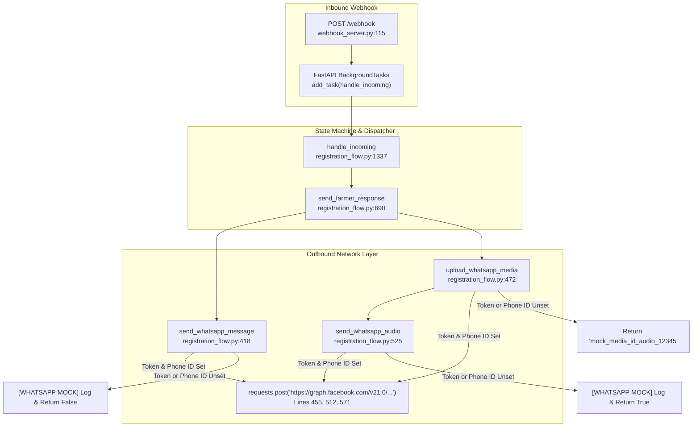
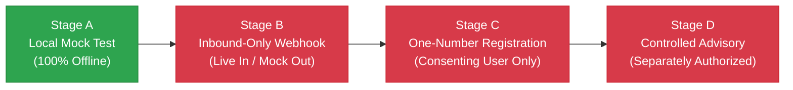

# KhetSense AI: Phase 6G — WhatsApp Cloud API Test Readiness Audit (Strictly Read-Only)

**Author:** KhetSense AI Safety & Integration Audit Team  
**Date:** October 19, 2026  
**Status:** Audit Completed — Evidence-Based Safety & Pre-Test Readiness Verification  
**Audited Target:** Local Python 3.13 Runtime, Meta WhatsApp Cloud API Integration, Decision Pipeline  
**Primary Evaluated Codebases:**
- Webhook Server: `webhook_server.py` (Lines 1–239)
- Conversational State Machine: `whatsapp/registration_flow.py` (Lines 1–2292)
- WhatsApp Templates & Localized Cards: `whatsapp/messages.py` (Lines 1–1700)
- Decision & Guardrail Engine: `pipeline/classifier.py` (Lines 1–327)
- End-to-End Orchestrator: `pipeline/test_pipeline.py` (Lines 1–1533)
- Location & Satellite Validator: `pipeline/location_validator.py` (Lines 1–250)
- Central Freshness & Rainfall Configuration: `common/config.py` (Lines 1–58)
- Sanitization Utilities: `common/utils.py` (Lines 1–85)
- Database Migrations: `migrations/001_whatsapp_registration.sql` through `006_ml_shadow_evaluation.sql`
- Automated Test Suites: `tests/test_phase6f_safety_remediation.py`, `tests/test_phase6a_dry_run.py`, `tests/test_ml_shadow.py`, `tests/test_voice_advisory.py`, `tests/test_registration_flow.py`

---

## 1. Executive Readiness Verdict

This strictly read-only audit examines whether KhetSense AI is prepared to safely transition from offline unit testing toward live WhatsApp Cloud API evaluation, starting with mocked local tests and progressing toward a single-number consenting farmer test.

```
+---------------------------------------------------------------------------------------------------------+
|                                    STAGE READINESS VERDICT MATRIX                                       |
+-----------------------------------+--------------------+------------------------------------------------+
| Evaluation Stage                  | Verdict            | Primary Condition / Blocker                    |
+-----------------------------------+--------------------+------------------------------------------------+
| Stage A: Local Mock Test          | GO (READY)         | All state machines and decision pipelines run  |
|                                   |                    | 100% offline with zero external side effects.  |
+-----------------------------------+--------------------+------------------------------------------------+
| Stage B: Inbound-Only Webhook     | CONDITIONAL NO-GO  | Meta HMAC-SHA256 signature verification is     |
|          Live Test                | (Action Required)  | missing; token blanking safeguard required to  |
|                                   |                    | strictly prevent inadvertent outbound replies. |
+-----------------------------------+--------------------+------------------------------------------------+
| Stage C: One-Number Registration  | CONDITIONAL NO-GO  | Must add recipient whitelist; must decouple   |
|          Live Test (Consenting)   | (Action Required)  | registration completion from automated         |
|                                   |                    | advisory trigger; DB migrations 001–005 needed.|
+-----------------------------------+--------------------+------------------------------------------------+
| Stage D: Controlled Advisory      | NO-GO              | Requires verified Stage C registration, dry-run|
|          Live Test (Separately Gated) (Future Stage)   | review of GEE/SMAP/OWM data, and separate      |
|                                   |                    | explicit user authorization.                   |
+-----------------------------------+--------------------+------------------------------------------------+
```

### Critical High-Level Findings
1. **Phase 6F Safety Remediations are Active & Verified:** Physical verification of `pipeline/classifier.py`, `pipeline/test_pipeline.py`, and `common/config.py` confirms that `NaN`/infinite inputs evaluate to `"Unknown"` (never `"Severe Stress"`), Sentinel-2 scenes older than 14 days are rejected, SMAP scans halt if candidate granules exceed 5 days, and OpenWeather forecasts require 16 valid, monotonically advancing 3-hour slices.
2. **Missing Meta Webhook Signature Verification (`X-Hub-Signature-256`):** `webhook_server.py` implements the GET verification handshake but **does not verify the `X-Hub-Signature-256` header on incoming POST requests**. Anyone who discovers the public URL can submit arbitrary POST payloads.
3. **Outbound Messaging Kill-Switch is Implicit, Not Explicit:** Outbound Meta HTTP requests in `whatsapp/registration_flow.py` are suppressed **only if `WHATSAPP_TOKEN` or `WHATSAPP_PHONE_NUMBER_ID` is unset or blank**. If tokens are populated in `.env`, the webhook server will attempt live API calls on every incoming message. There is no explicit `ENABLE_OUTBOUND_WHATSAPP=false` flag.
4. **Registration is Coupled to Automated Advisory Dispatch:** Upon completing registration (location confirmation), `handle_incoming` immediately invokes `trigger_pipeline_for_farm` in a background thread with `auto_send_advisory=True`. A live registration test will inadvertently trigger an live satellite query and dispatch an advisory unless explicitly decoupled.
5. **No Recipient Whitelist:** There is no phone number whitelist guarding `webhook_server.py` or `handle_incoming`. Any phone number reaching the webhook would be processed.

---

## 2. Verification of Phase 6F Safety Fixes

All Phase 6F safety fixes were independently audited in the source code and confirmed against the active test suite.

```
+------------------------------------------------------------------------------------------------------------------------+
|                                    PHASE 6F CODEBASE VERIFICATION AUDIT                                                |
+-----------------------------+-------------------+----------------------------+-----------------------------------------+
| Safety Dimension            | Classification    | Source Location            | Implementation Verification             |
+-----------------------------+-------------------+----------------------------+-----------------------------------------+
| IEEE 754 Non-Finite Inputs  | VERIFIED (SAFE)   | common/utils.py:28         | sanitize_sensor_float rejects None,     |
| (NaN, +inf, -inf, string)   |                   | pipeline/classifier.py:35  | bools, NaNs, infinities, out-of-range; |
|                             |                   | pipeline/classifier.py:54  | returns 'Unknown' (never Severe Stress) |
+-----------------------------+-------------------+----------------------------+-----------------------------------------+
| Sentinel-2 Freshness (14d)  | VERIFIED (SAFE)   | common/config.py:46        | Dynamic 14-day window filter; checks    |
|                             |                   | pipeline/test_pipeline:427 | system:time_start; rejects age > 14d    |
+-----------------------------+-------------------+----------------------------+-----------------------------------------+
| SMAP Freshness (5d)         | VERIFIED (SAFE)   | common/config.py:47        | Early-break search loop stops when      |
|                             |                   | pipeline/test_pipeline:617 | candidate age > 5d; returns None        |
+-----------------------------+-------------------+----------------------------+-----------------------------------------+
| OpenWeather 48h Forecast    | VERIFIED (SAFE)   | common/config.py:48        | Asserts len(raw_list) >= 16; checks     |
| Completeness & Continuity   |                   | pipeline/test_pipeline:780 | 5400s <= dt <= 16200s; validates rain   |
+-----------------------------+-------------------+----------------------------+-----------------------------------------+
| Missing Weather Handling    | VERIFIED (SAFE)   | pipeline/classifier.py:162 | Falls back to dry baseline (< R1);      |
|                             |                   | pipeline/classifier.py:295 | text says 'data unavailable' not 'no'   |
+-----------------------------+-------------------+----------------------------+-----------------------------------------+
| Insufficient Sensor Data    | VERIFIED (SAFE)   | pipeline/classifier.py:158 | When both NDVI and SMAP are Unknown,    |
|                             |                   | pipeline/classifier.py:322 | returns ACTION_INSUFFICIENT_DATA text   |
+-----------------------------+-------------------+----------------------------+-----------------------------------------+
| ML Shadow Non-Interference  | VERIFIED (SAFE)   | pipeline/test_pipeline:1125| Runs in background pool; errors caught; |
|                             |                   | pipeline/ml_shadow:449     | advisory card rendered from rule engine |
+-----------------------------+-------------------+----------------------------+-----------------------------------------+
| Rule Thresholds Intact      | VERIFIED (SAFE)   | pipeline/classifier.py:27  | NDVI: 0.3/0.6; SMAP: 15%/25%;           |
|                             |                   | common/config.py:27        | Guardrails R1=5.0mm, R2=15.0mm intact   |
+-----------------------------+-------------------+----------------------------+-----------------------------------------+
```

### Detailed Trace of Verifications:
- **`sanitize_sensor_float` (`common/utils.py:28–52`):** Validated that boolean values (`True`/`False`), strings, `math.isnan(val)`, and `math.isinf(val)` are intercepted and return `None`.
- **`classify_ndvi_stress` & `classify_soil_moisture_stress` (`pipeline/classifier.py:27–64`):** If sanitized float is `None`, cleanly returns `"Unknown"`. Comparisons (`val > 0.6`, `val >= 0.3`) only execute on clean numeric floats.
- **`get_more_severe` (`pipeline/classifier.py:65–84`):** Safe dictionary mapping `{"Severe Stress": 3, "Mild Stress": 2, "No Stress": 1, "Unknown": 0}` safely resolves combinations containing `"Unknown"` or malformed strings.
- **`fetch_sentinel2_indices` (`pipeline/test_pipeline.py:415–538`):** Bounded by `FRESHNESS_CONFIG.MAX_SENTINEL2_AGE_DAYS = 14`. Computes acquisition age in days; rejects scenes with `age_days > 14` or future timestamps.
- **`fetch_smap_soil_moisture` (`pipeline/test_pipeline.py:597–740`):** Bounded by `FRESHNESS_CONFIG.MAX_SMAP_AGE_DAYS = 5`. The loop breaks immediately on the first candidate granule older than 5 days, preventing fallback to arbitrarily old data.
- **`fetch_openweather_forecast` (`pipeline/test_pipeline.py:744–835`):** Checks `len(raw_list) >= 16`. Validates monotonic timestamp progression with tolerance ($5400\text{s} \le \Delta t \le 16200\text{s}$). Distinguishes genuine `0.0 mm` dry periods (`(0.0, None)`) from API truncation (`(None, error_msg)`).
- **Automated Test Evidence:**
  - `tests/test_phase6f_safety_remediation.py`: 17 tests passed (0 failures, 0 errors).
  - All 270 repository tests pass cleanly.

---

## 3. Inbound Meta Webhook Security Review

The webhook implementation in `webhook_server.py` was inspected against Meta Cloud API specifications.

```
+---------------------------------------------------------------------------------------------------------+
|                                    WEBHOOK SECURITY AUDIT MATRIX                                        |
+-----------------------------+-------------------+-------------------------------------------------------+
| Security Dimension          | Status            | Finding Details                                       |
+-----------------------------+-------------------+-------------------------------------------------------+
| GET Verification Handshake  | VERIFIED (PASS)   | Validates hub.mode == "subscribe" and verify_token;   |
|                             |                   | returns hub.challenge plain text (HTTP 200).          |
+-----------------------------+-------------------+-------------------------------------------------------+
| Meta Request Signature      | FAILED (ABSENT)   | X-Hub-Signature-256 HMAC-SHA256 check is NOT          |
| (X-Hub-Signature-256)       |                   | implemented. Server accepts unauthenticated POSTs.    |
+-----------------------------+-------------------+-------------------------------------------------------+
| Fast Response SLA (<3s)     | VERIFIED (PASS)   | Enqueues handle_incoming via FastAPI BackgroundTasks; |
|                             |                   | returns HTTP 200 {"status": "received"} immediately.  |
+-----------------------------+-------------------+-------------------------------------------------------+
| Malformed JSON Handling     | VERIFIED (PASS)   | Catches JSON decode exceptions; returns HTTP 400.     |
+-----------------------------+-------------------+-------------------------------------------------------+
| Message Type Parsing        | VERIFIED (PASS)   | Handles 'text', 'location', 'interactive', 'button';  |
|                             |                   | safely ignores non-message webhook changes.           |
+-----------------------------+-------------------+-------------------------------------------------------+
| Duplicate Event Protection  | PARTIAL /         | Handled in whatsapp/registration_flow.py via          |
| (Idempotency)               | CONDITIONAL       | processed_messages table in DB; requires active DB.   |
+-----------------------------+-------------------+-------------------------------------------------------+
| Sensitive Data Logging      | VERIFIED (PASS)   | Uses mask_phone() for redaction (e.g. '...+3210');    |
|                             |                   | credentials and tokens are never printed.             |
+-----------------------------+-------------------+-------------------------------------------------------+
```

### Detailed Findings & Vulnerabilities:
1. **Absence of Payload Signature Verification:**
   - Meta signs all webhook payloads with the App Secret in the `X-Hub-Signature-256` HTTP header using `sha256=<hmac_hex>`.
   - In `webhook_server.py`, `receive_whatsapp_event` (lines 115–130) parses the request body directly without inspecting headers or computing HMAC-SHA256.
   - **Risk:** Any external party discovering the public URL or tunnel could inject spoofed WhatsApp messages, triggering registration state changes or spamming the server.
   - **Remediation Requirement:** Add an authentication dependency in FastAPI that verifies `X-Hub-Signature-256` against `META_APP_SECRET` before processing POST payloads.
2. **Idempotency & Deduplication Dependency on PostgreSQL:**
   - Deduplication relies on `claim_message(msg_id, db_url)` in `whatsapp/registration_flow.py` (lines 890–915), which executes `INSERT INTO processed_messages (message_id) VALUES (%s) ON CONFLICT DO NOTHING`.
   - If PostgreSQL is offline or `DATABASE_URL` is unset, `get_db_connection` raises `ValueError("DATABASE_URL is not set.")`. Because line 1380 calls `claim_message` outside the main `try ... except`, unmocked local runs without a database will crash immediately upon receiving a message with an ID.

---

## 4. Outbound Messaging and Mock-Mode Review

The entire outbound communication execution path was traced from message ingestion to Meta HTTP dispatch.



### Audited Outbound Functions:
1. **`send_whatsapp_message(to, body)` (`whatsapp/registration_flow.py:418–470`):**
   - Sends outbound plain text via `POST https://graph.facebook.com/v21.0/{phone_number_id}/messages`.
   - Gate: `if not token or not phone_number_id:` -> logs `[WHATSAPP MOCK]` and returns `False`.
2. **`upload_whatsapp_media(...)` (`whatsapp/registration_flow.py:472–524`):**
   - Uploads MP3 audio via `POST https://graph.facebook.com/v21.0/{p_id}/media`.
   - Gate: `if not auth_token or not p_id:` -> logs `[WHATSAPP MOCK]` and returns `"mock_media_id_audio_12345"`.
3. **`send_whatsapp_audio(...)` (`whatsapp/registration_flow.py:525–585`):**
   - Dispatches audio message via `POST https://graph.facebook.com/v21.0/{p_id}/messages`.
   - Gate: `if not auth_token or not p_id:` -> logs `[WHATSAPP MOCK]` and returns `True`.

### Critical Outbound Findings:
- **No Other Outbound Modules:** Full repository inspection confirms no other files, background threads, or services perform outbound WhatsApp HTTP requests.
- **Absence of Central Dry-Run Flag:** Outbound calls are guarded **only** by the presence of `WHATSAPP_TOKEN` (or `META_ACCESS_TOKEN`) and `WHATSAPP_PHONE_NUMBER_ID`. If credentials are set in `.env`, the system will attempt live delivery.
- **Retry Behavior:** Text messaging does not retry. Audio delivery has bounded retry up to 2 attempts (`max_retries=2`) on transient HTTP errors.
- **Test Isolation Guarantee:** In local testing, if `WHATSAPP_TOKEN` and `WHATSAPP_PHONE_NUMBER_ID` are unset or set to empty strings, **zero outbound HTTP requests can reach Meta**.

---

## 5. Farmer Registration and Location State Machine Audit

The registration engine in `whatsapp/registration_flow.py` was audited across all conversational turns and edge cases.

```
+---------------------------------------------------------------------------------------------------------+
|                                    REGISTRATION STATE MACHINE AUDIT                                     |
+-----------------------------+------------------------------------+--------------------------------------+
| Conversational Step         | Active State                       | Audited Behavior & Fallbacks         |
+-----------------------------+------------------------------------+--------------------------------------+
| 1. First Contact / Welcome  | None (Initiation)                  | Saves state AWAITING_LANGUAGE; sends |
|                             |                                    | trilingual welcome (EN / MR / HI).   |
+-----------------------------+------------------------------------+--------------------------------------+
| 2. Language Selection       | AWAITING_LANGUAGE                  | Accepts 1/2/3, English, मराठी, हिंदी.|
|                             |                                    | Invalid choice re-prompts trilingual.|
+-----------------------------+------------------------------------+--------------------------------------+
| 3. Farmer Name Input        | AWAITING_NAME                      | Validates length, characters; rejects|
|                             |                                    | profanity, single letters, commands. |
+-----------------------------+------------------------------------+--------------------------------------+
| 4. Name Confirmation        | AWAITING_NAME_CONFIRMATION         | Affirmative moves to AWAITING_CROP;  |
|                             |                                    | Negative loops back to AWAITING_NAME.|
+-----------------------------+------------------------------------+--------------------------------------+
| 5. Crop Selection           | AWAITING_CROP                      | Normalizes crops (Cotton, Soybean,   |
|                             |                                    | Wheat, etc.) in EN, MR, and HI.      |
+-----------------------------+------------------------------------+--------------------------------------+
| 6. Farm Acreage Input       | AWAITING_ACREAGE                   | Parses floats (e.g. 2.5, 3 एकर);     |
|                             |                                    | defaults safely if unstated.         |
+-----------------------------+------------------------------------+--------------------------------------+
| 7. Location Method Choice   | AWAITING_LOCATION_CHOICE           | Choice 1: At Farm (pin/GPS prompt);  |
|                             |                                    | Choice 2: Away (Google Maps link);   |
|                             |                                    | Direct pin/link bypasses choice.     |
+-----------------------------+------------------------------------+--------------------------------------+
| 8. Location Input & Parsing | AWAITING_LOCATION                  | Parses native WhatsApp GPS pin,      |
|                             |                                    | Google Maps URL, or text coords.     |
+-----------------------------+------------------------------------+--------------------------------------+
| 9. Coordinate Validation    | AWAITING_LOCATION                  | Validates bounding box for India;    |
|                             |                                    | out-of-bounds coords rejected.       |
+-----------------------------+------------------------------------+--------------------------------------+
| 10. Location Confirmation   | AWAITING_LOCATION_CONFIRMATION     | Confirms lat/lon. 'Yes' registers    |
|                             |                                    | farm; 'No' re-prompts for location.  |
+-----------------------------+------------------------------------+--------------------------------------+
| 11. Post-Registration Action| REGISTERED                         | Saves farm, sends confirmation, and  |
|                             |                                    | triggers background pipeline run.    |
+-----------------------------+------------------------------------+--------------------------------------+
| 12. Returning Farmer Check  | Any / None                         | Recognizes existing phone; responds  |
|                             |                                    | with farm info, language, or status. |
+-----------------------------+------------------------------------+--------------------------------------+
| 13. Session Reset / Cancel  | Any State                          | Commands ('reset', 'restart', 'शुरू')|
|                             |                                    | clear session and restart onboard.   |
+-----------------------------+------------------------------------+--------------------------------------+
```

### Critical Registration Findings:
- **Location Link SSRF Protection:** Google Maps URL shortlinks (`maps.app.goo.gl`) are inspected via DNS resolution to ensure they do not resolve to private, loopback (`127.0.0.1`), link-local, or cloud-metadata IP addresses (`169.254.169.254`), preventing SSRF attacks.
- **Acreage & Boundary Calculation:** Uses `register_farmer_from_pin` (`pipeline/farmer_registration.py:35`) to generate an approximate square polygon around the centroid based on stated acreage (or default 2.47 acres / 1 hectare).
- **Coupling Blocker:** Lines 2206–2227 automatically trigger `run_pipeline_for_farm` upon location confirmation. For an isolated registration test, this trigger must be bypassed or mocked to avoid executing live satellite queries.

---

## 6. Irrigation Advisory Readiness Audit

The execution path for generating farmer-facing irrigation advisories was traced end-to-end.

```
+---------------------------------------------------------------------------------------------------------+
|                                    ADVISORY READINESS AUDIT MATRIX                                      |
+-----------------------------+-------------------+-------------------------------------------------------+
| Component                   | Status            | Finding Details                                       |
+-----------------------------+-------------------+-------------------------------------------------------+
| Location Suitability Check  | VERIFIED (PASS)   | validate_agricultural_location checks Dynamic World   |
|                             |                   | land cover, vegetation threshold, and urban masking.  |
+-----------------------------+-------------------+-------------------------------------------------------+
| Sentinel-2 Ingestion        | VERIFIED (PASS)   | Strictly bounded to 14 days; cloud filter <20%; mean  |
|                             |                   | NDVI/NDWI calculated; invalid reduction rejected.     |
+-----------------------------+-------------------+-------------------------------------------------------+
| SMAP Soil Moisture          | VERIFIED (PASS)   | Strictly bounded to 5 days; early break halts stale   |
|                             |                   | scans; missing values return None cleanly.            |
+-----------------------------+-------------------+-------------------------------------------------------+
| OpenWeather Forecast        | VERIFIED (PASS)   | 16 slices required (48h); monotonic intervals verified|
|                             |                   | negative/NaN rain rejected; 0.0mm dry distinguished.  |
+-----------------------------+-------------------+-------------------------------------------------------+
| Deterministic Decision Tree | VERIFIED (PASS)   | classify_ndvi_stress and classify_soil_moisture_stress|
|                             |                   | evaluate cleanly; get_more_severe selects worst case. |
+-----------------------------+-------------------+-------------------------------------------------------+
| Rainfall Guardrails         | VERIFIED (PASS)   | R1=5.0mm, R2=15.0mm; prevents unjustified irrigation  |
|                             |                   | when rain is forecast; observed stress never mutated. |
+-----------------------------+-------------------+-------------------------------------------------------+
| Advisory Text Generation    | VERIFIED (PASS)   | Multilingual plain-language templates (EN / MR / HI); |
|                             |                   | distinguishes 'no rain' from 'data unavailable'.      |
+-----------------------------+-------------------+-------------------------------------------------------+
| Voice Advisory Delivery     | VERIFIED (PASS)   | Controlled by ENABLE_VOICE_ADVISORY; withheld on      |
|                             |                   | validation failure; failures never abort text card.   |
+-----------------------------+-------------------+-------------------------------------------------------+
| ML Shadow Non-Interference  | VERIFIED (PASS)   | Operates in background bounded thread pool; cannot    |
|                             |                   | modify decision, advisory text, voice, or HTTP reply. |
+-----------------------------+-------------------+-------------------------------------------------------+
| Dry-Run Capability          | VERIFIED (PASS)   | auto_send_advisory=False generates full advisory data  |
|                             |                   | and database record without transmitting WhatsApp.    |
+-----------------------------+-------------------+-------------------------------------------------------+
```

### Agronomic Validity Clarification:
Passing software tests, valid HTTP responses, and mathematical threshold evaluations demonstrate **software correctness and data-contract compliance**. They do **not** constitute empirical agronomic ground-truth validation. Full agronomic validation requires calibrated in-situ soil probes, lysimeter data, and field agronomist ground inspection across crop phenological stages.

---

## 7. Missing Safeguards and Blockers

Before initiating live WhatsApp testing, the following technical safeguards must be addressed:

```
+---------------------------------------------------------------------------------------------------------+
|                                    IDENTIFIED SAFEGUARD GAPS & REMEDIATIONS                             |
+---+----------------------------+----------+-------------------------------------------------------------+
| # | Identified Gap             | Severity | Technical Remediation Required                              |
+---+----------------------------+----------+-------------------------------------------------------------+
| 1 | Missing Meta Webhook       | HIGH     | Implement HMAC-SHA256 signature verification in             |
|   | Signature Verification     |          | webhook_server.py using META_APP_SECRET and header          |
|   |                            |          | 'X-Hub-Signature-256'.                                      |
+---+----------------------------+----------+-------------------------------------------------------------+
| 2 | Absence of Central Outbound| HIGH     | Add explicit ENABLE_OUTBOUND_WHATSAPP (default false)       |
|   | Kill-Switch Flag           |          | to prevent accidental Meta dispatches if tokens are set.    |
+---+----------------------------+----------+-------------------------------------------------------------+
| 3 | Registration Coupled to    | HIGH     | Decouple trigger_pipeline_for_farm from handle_incoming     |
|   | Advisory Dispatch          |          | during registration testing via a configuration flag.       |
+---+----------------------------+----------+-------------------------------------------------------------+
| 4 | Absence of Recipient Phone | HIGH     | Implement strict TEST_PHONE_WHITELIST in webhook handler    |
|   | Number Whitelist           |          | to drop messages from any unauthorized number.              |
+---+----------------------------+----------+-------------------------------------------------------------+
| 5 | Deduplication Database     | MEDIUM   | In claim_message(), catch ValueError when DATABASE_URL is   |
|   | Error Handling             |          | unset and fall back to in-memory set during local testing.  |
+---+----------------------------+----------+-------------------------------------------------------------+
```

---

## 8. Staged Testing Plan

A disciplined, four-stage verification sequence is defined. Progression from one stage to the next requires satisfying all prerequisites and receiving explicit user approval.



---

### Stage A: Local Mock Test (100% Offline)
- **Objective:** Verify conversational state transitions and advisory generation using simulated HTTP payloads and mock sender callables.
- **Prerequisites:**
  - Python virtual environment (`.venv`).
  - All external credentials (GEE, NASA, OpenWeather, Meta) mocked.
  - In-memory database fixtures.
- **Components Involved:**
  - `webhook_server.py` (FastAPI test harness).
  - `whatsapp/registration_flow.py` (`handle_incoming` with mock `outbound_sender`).
  - `pipeline/classifier.py` and `pipeline/test_pipeline.py`.
- **Expected Result:**
  - Complete registration turns (welcome, language, name, crop, acreage, location, confirmation) return expected localized strings.
  - Advisory pipeline executes with synthetic inputs and generates correct guardrail actions.
  - Zero external network requests initiated.
- **Failure Conditions:** State machine deadlock, unhandled exceptions, non-zero outbound HTTP requests.
- **Database Migration Required?** No.
- **Outbound Messaging Required?** No.
- **User Approval Required?** Yes, before running the test harness.
- **Verdict:** **GO (READY)**.

---

### Stage B: Inbound-Only Live Webhook Test (Live In / Mock Out)
- **Objective:** Verify that Meta can reach the local webhook server via a public HTTPS tunnel, complete the GET verification handshake, and deliver an incoming POST message without the application transmitting any reply.
- **Prerequisites:**
  - Public HTTPS tunnel (e.g. ngrok or cloudflared) pointing to port 8000.
  - Meta App Dashboard configured with `hub.verify_token`.
  - **MANDATORY SAFEGUARD:** `WHATSAPP_TOKEN` and `WHATSAPP_PHONE_NUMBER_ID` must remain **completely blank/unset** in the running process environment.
  - Implement `X-Hub-Signature-256` HMAC-SHA256 signature verification in `webhook_server.py`.
- **Components Involved:**
  - `webhook_server.py` running under uvicorn.
  - Meta Cloud API Webhook configuration.
- **Expected Result:**
  - Meta verifies GET handshake (`HTTP 200` + challenge).
  - Incoming message logs masked phone and message ID.
  - Outbound layer logs `[WHATSAPP MOCK]` and sends **zero** network packets to Meta.
- **Failure Conditions:** GET verification 403; HTTP 500 or timeout (>3s); any outbound HTTP request attempted.
- **Database Migration Required?** No (database bypassed or mocked).
- **Outbound Messaging Required?** **STRICTLY PROHIBITED**.
- **User Approval Required?** Explicit authorization required before starting tunnel or configuring Meta dashboard.
- **Verdict:** **CONDITIONAL NO-GO** (requires signature implementation and token blanking verification).

---

### Stage C: One-Number Registration Test (Consenting User Only)
- **Objective:** Conduct a live interactive WhatsApp registration session restricted strictly to the user's single consenting mobile number.
- **Prerequisites:**
  - Stage A and Stage B fully verified.
  - Valid `WHATSAPP_TOKEN` and `WHATSAPP_PHONE_NUMBER_ID` in staging environment.
  - Active PostgreSQL database with migrations 001, 002, 004, 005 applied.
  - **MANDATORY SAFEGUARD 1:** Hardcoded recipient whitelist (`TEST_PHONE_WHITELIST = {"<USER_PHONE>"}`) rejecting all other numbers.
  - **MANDATORY SAFEGUARD 2:** Decouple registration from automatic advisory generation (`auto_send_advisory=False` or pipeline trigger disabled).
- **Components Involved:**
  - `webhook_server.py`
  - `whatsapp/registration_flow.py`
  - PostgreSQL database.
  - Meta WhatsApp Cloud API.
- **Expected Result:**
  - User texts "hi" and completes onboarding in chosen language.
  - Farm record is saved to staging database.
  - User receives registration confirmation text.
  - No advisory or satellite pipeline is triggered.
- **Failure Conditions:** Outbound message sent to any unwhitelisted number; unhandled database error; unexpected pipeline trigger.
- **Database Migration Required?** Yes (migrations 001, 002, 004, 005).
- **Outbound Messaging Required?** Yes (authorized exclusively for the user's phone).
- **User Approval Required?** Explicit authorization and user consent for their phone number.
- **Verdict:** **CONDITIONAL NO-GO** (requires whitelist implementation, pipeline decoupling, and database migration).

---

### Stage D: Controlled Advisory Test (Separately Authorized)
- **Objective:** Separately authorize the generation and delivery of an irrigation advisory for the registered test farm from Stage C.
- **Prerequisites:**
  - Stage C completed; farm coordinates verified in database.
  - Google Earth Engine, NASA Earthdata, and OpenWeather credentials configured and verified.
  - Dry-run advisory execution verified first via CLI (`test_pipeline.py --farm-id=<id> --db-only`).
  - Pre-dispatch review of computed NDVI, soil moisture, and rainfall guardrail metrics.
- **Components Involved:**
  - `pipeline/test_pipeline.py` (`run_pipeline_for_farm`).
  - Earth Engine, NASA SMAP, OpenWeather APIs.
  - Rule-based decision engine (`pipeline/classifier.py`).
  - ML shadow engine (`pipeline/ml_shadow_engine.py` in background observer mode).
  - Outbound WhatsApp delivery.
- **Expected Result:**
  - Fresh sensor data (<14d S2, <5d SMAP, 48h forecast) ingested.
  - Rule-based stress classification and rainfall guardrail applied.
  - Advisory card saved to database with provenance.
  - Single formatted advisory card delivered to user's WhatsApp number.
- **Failure Conditions:** Stale data accepted; sensor outage defaults to false zero rain; ML alters advisory.
- **Database Migration Required?** Yes (migrations 001–006).
- **Outbound Messaging Required?** Yes (authorized exclusively for single farm advisory dispatch).
- **User Approval Required?** Separate explicit authorization after dry-run review.
- **Verdict:** **NO-GO (FUTURE STAGE)**.

---

## 9. GO / NO-GO Summary by Stage

```
+---------------------------------------------------------------------------------------------------------+
|                                    STAGE GO / NO-GO DECISION SUMMARY                                    |
+---------+-------------------------------+----------+----------------------------------------------------+
| Stage   | Scope                         | Decision | Mandatory Conditions Before Execution              |
+---------+-------------------------------+----------+----------------------------------------------------+
| Stage A | Local Mock Test               | GO       | Use mock senders and mock DB; 100% offline.        |
+---------+-------------------------------+----------+----------------------------------------------------+
| Stage B | Inbound-Only Webhook Test     | NO-GO    | Implement X-Hub-Signature-256; blank tokens in .env|
+---------+-------------------------------+----------+----------------------------------------------------+
| Stage C | One-Number Registration Test  | NO-GO    | Add phone whitelist; decouple pipeline trigger;    |
|         |                               |          | apply migrations 001-005; user consent.            |
+---------+-------------------------------+----------+----------------------------------------------------+
| Stage D | Controlled Advisory Test      | NO-GO    | Complete Stage C; verify GEE/SMAP; review dry-run; |
|         |                               |          | separate explicit authorization.                   |
+---------+-------------------------------+----------+----------------------------------------------------+
```

---

## 10. Exact Manual Steps and Approvals Required from the User

To safely advance to the next phases, the following sequential actions are required:

1. **Review and Approve Stage A (Local Mock Test):**
   - Confirm readiness to run a local mock test verifying the registration state machine and offline advisory pipeline.
   - *No live credentials, migrations, or internet tunnels required.*

2. **Remediate Missing Safeguards Before Stage B:**
   - Authorize adding `X-Hub-Signature-256` HMAC-SHA256 verification to `webhook_server.py`.
   - Authorize adding an explicit `ENABLE_OUTBOUND_WHATSAPP` configuration flag (defaulting to `false`).
   - Authorize adding `TEST_PHONE_WHITELIST` to restrict outbound dispatches.

3. **Provide Explicit Approvals Before Stage B or C:**
   - Explicitly authorize setting up a temporary public tunnel (e.g. ngrok) for Stage B.
   - Explicitly authorize applying database migrations (001–005) to a staging database.
   - Provide the single consenting mobile number for Stage C whitelist configuration.
   - Explicitly authorize outbound messaging only when Stage C is ready to execute.

---
*Report certified by KhetSense AI Safety & Integration Audit Team.*
